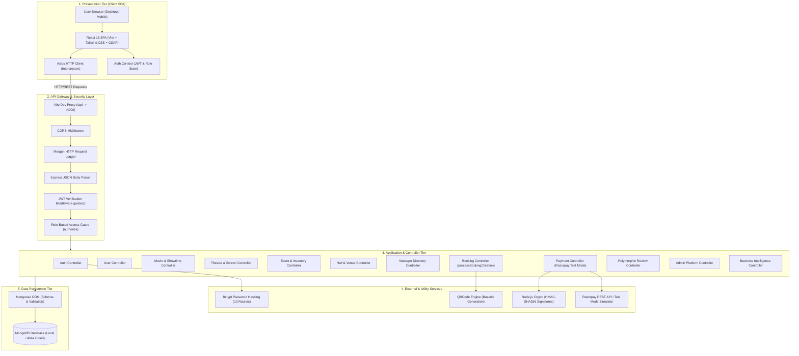
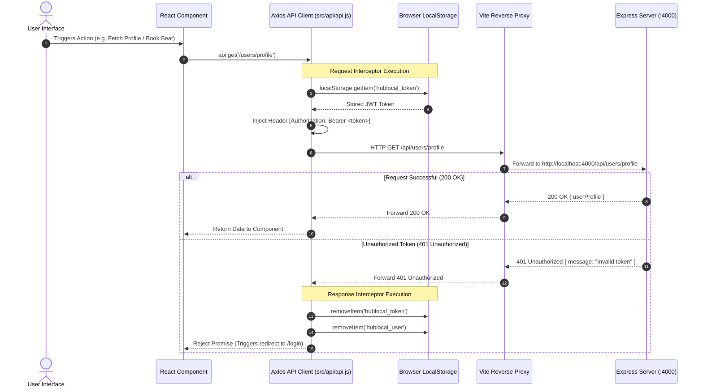
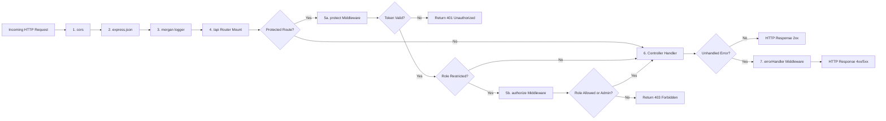
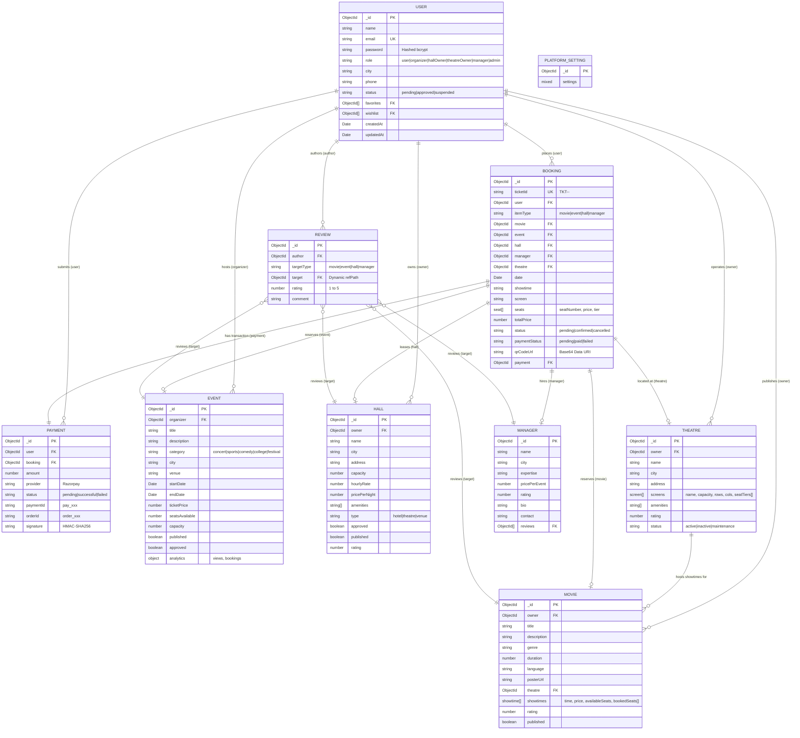
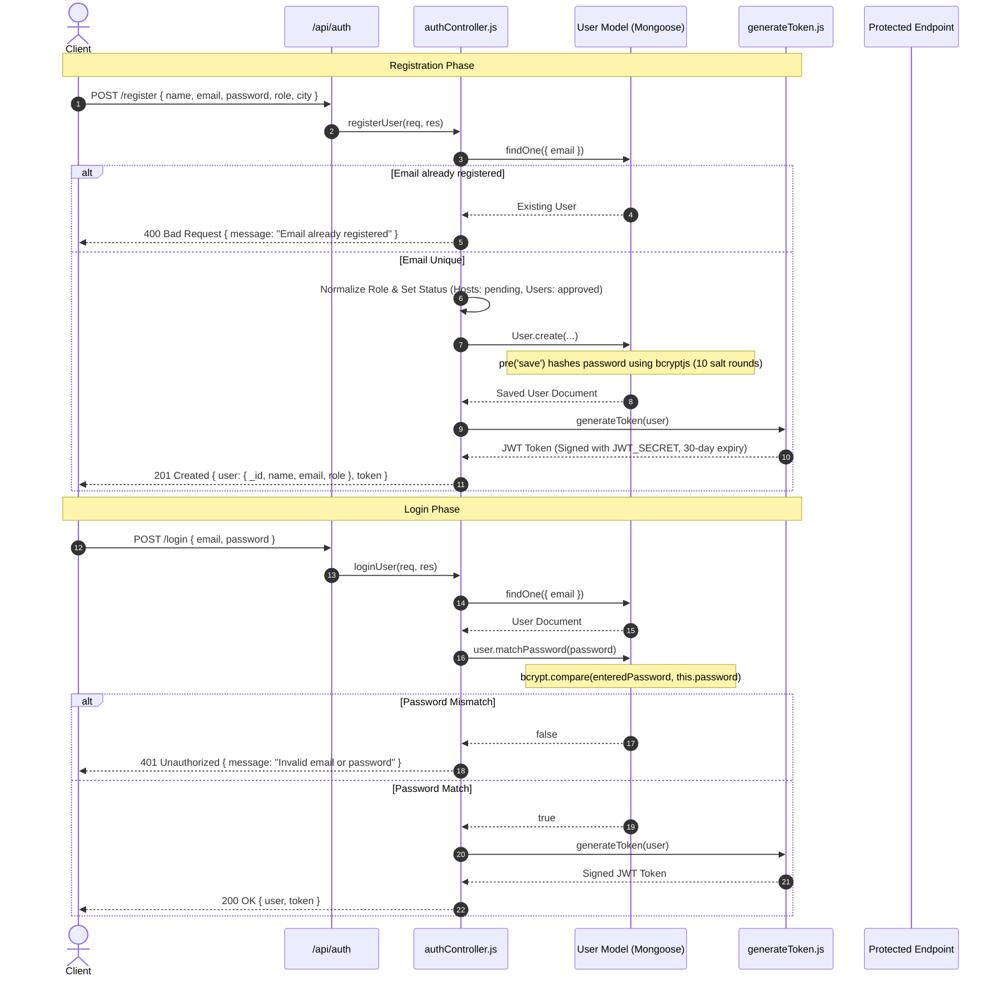
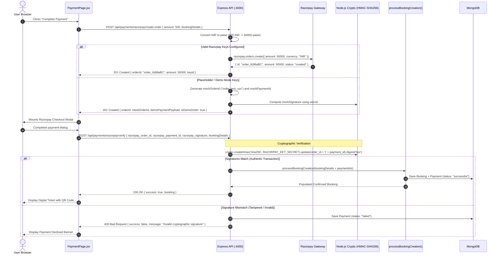
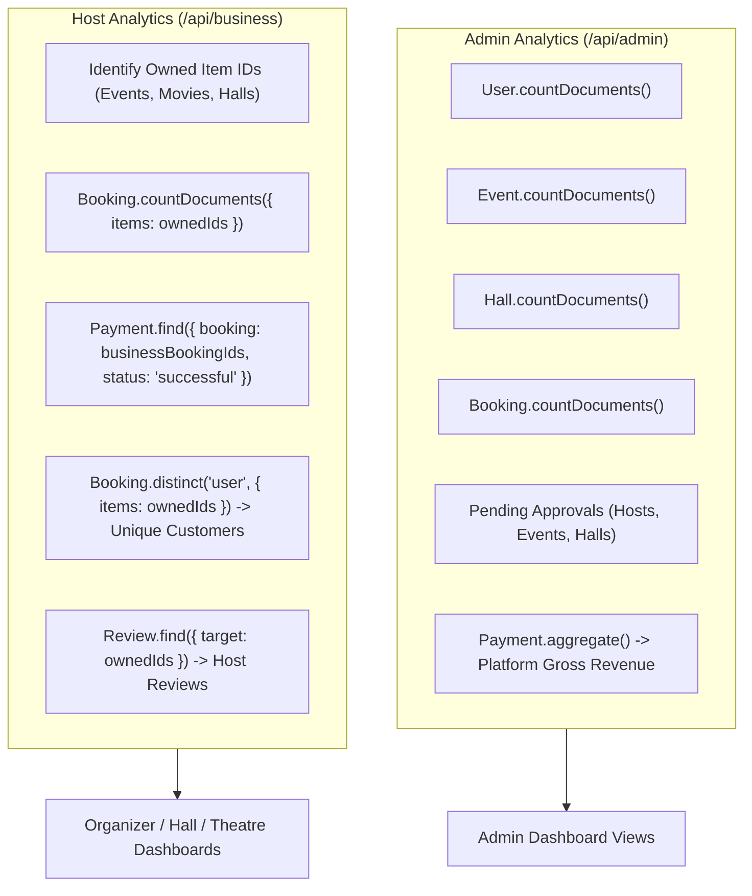

# System Architecture Specification - Hyper Local Event Hub

> **A Comprehensive Engineering Document Detailing System Architecture, Client-Server Communication, REST API Pipelines, Controllers, Middleware, Data Persistence Schemas, Authentication Lifecycle, Booking & Payment Workflows, and Role-Based Access Control (RBAC).**

---

## 📑 Table of Contents

1. [🏛️ High-Level System Architecture](#️-high-level-system-architecture)
2. [🌐 Frontend-to-Backend Communication & Networking](#-frontend-to-backend-communication--networking)
3. [⚙️ Middleware Execution Pipeline](#️-middleware-execution-pipeline)
4. [🗄️ Database Models & Entity-Relationship Architecture](#️-database-models--entity-relationship-architecture)
5. [🔐 Authentication & Authorization Lifecycle](#-authentication--authorization-lifecycle)
6. [🎟️ End-to-End Booking Engine & Concurrency Control](#️-end-to-end-booking-engine--concurrency-control)
7. [💳 Payment Processing & Razorpay Verification Flow](#-payment-processing--razorpay-verification-flow)
8. [👥 User Role Permissions & Access Control Matrix (RBAC)](#-user-role-permissions--access-control-matrix-rbac)
9. [🔌 Complete REST API Routing & Controller Architecture](#-complete-rest-api-routing--controller-architecture)
10. [📊 Business & Administrative Intelligence Pipeline](#-business--administrative-intelligence-pipeline)

---

## 🏛️ High-Level System Architecture

**Hyper Local Event Hub** adopts a modern, decoupled **3-Tier Client-Server Architecture** augmented with specialized utility micro-services for cryptographic ticketing and payment gateway processing:



### Architectural Principles
1. **Separation of Concerns**: The user interface is completely decoupled from the server and communicates solely via stateless REST APIs.
2. **Stateless Scalability**: No session state is maintained in server memory. User identity and permissions are verified per request using signed JSON Web Tokens (JWT).
3. **Data Integrity & Concurrency**: Critical reservation resources (multiplex seats, event passes) are validated against current database state before write commitments to prevent race conditions and overbooking.
4. **Cryptographic Verifiability**: Bookings emit Base64 QR code tickets carrying cryptographically structured payloads that can be audited offline.

---

## 🌐 Frontend-to-Backend Communication & Networking

The frontend React application communicates with the backend Express API using a centrally configured Axios instance with automated request and response interceptors:



### 1. Reverse Proxy (`frontend/vite.config.js`)
To eliminate Cross-Origin Resource Sharing (CORS) preflight complexity during development and simulate unified origin hosting, Vite proxies all `/api` routes:
```javascript
export default defineConfig({
  plugins: [react()],
  server: {
    port: 3000,
    proxy: {
      '/api': 'http://localhost:4000'
    }
  }
});
```

### 2. Axios Request & Response Interceptors (`frontend/src/api/api.js`)
- **Request Interceptor**: Extracts the active JWT from `localStorage.getItem('hublocal_token')` and appends it to outgoing requests:
  ```javascript
  api.interceptors.request.use((config) => {
    let token = localStorage.getItem('hublocal_token');
    const existingAuth = config.headers?.Authorization;
    if (existingAuth && !existingAuth.includes('null')) {
      token = existingAuth.replace('Bearer ', '').trim();
    }
    if (token && token !== 'null') {
      config.headers.Authorization = `Bearer ${token}`;
    } else {
      delete config.headers.Authorization;
    }
    return config;
  });
  ```
- **Response Interceptor**: Automatically purges stale or corrupted credentials upon receiving an HTTP 401 status code:
  ```javascript
  api.interceptors.response.use(
    (response) => response,
    (error) => {
      if (error.response?.status === 401) {
        localStorage.removeItem('hublocal_token');
        localStorage.removeItem('hublocal_user');
      }
      return Promise.reject(error);
    }
  );
  ```

### 3. Context & State Management (`frontend/src/context/AuthContext.jsx`)
- Supplies global `user`, `token`, `login()`, `register()`, and `logout()` methods.
- Syncs state changes to `localStorage` reactively.
- Provides `normalizeUserRole()` and `getDashboardPath()` to dynamically redirect authenticated users to their corresponding dashboard:
  - `admin` $\rightarrow$ `/admin/dashboard`
  - `organizer` $\rightarrow$ `/organizer/dashboard`
  - `theatre_owner` $\rightarrow$ `/theatre-owner/dashboard`
  - `hall_owner` $\rightarrow$ `/hall-owner/dashboard`
  - `manager` $\rightarrow$ `/event-manager/dashboard`
  - `user` $\rightarrow$ `/user/dashboard`

---

## ⚙️ Middleware Execution Pipeline

Every incoming HTTP request traversing the Express application passes through a deterministic sequence of middleware layers:



### 1. Global Middleware
- **`cors()`**: Permits cross-origin resource sharing from client frontends.
- **`express.json()`**: Parses incoming JSON payloads and exposes them on `req.body`.
- **`morgan('dev')`**: Outputs real-time HTTP request status, method, URL, and response latency to the server terminal.

### 2. Security Middleware (`backend/src/middleware/auth.js`)
- **`protect`**:
  1. Inspects `req.headers.authorization` for `Bearer <token>`.
  2. Decodes the token using `jwt.verify(token, process.env.JWT_SECRET)`.
  3. Queries MongoDB via `User.findById(decoded.id).select('-password')`.
  4. Binds the sanitized user document directly to `req.user`.
- **`authorize(...roles)`**:
  1. Normalizes the incoming user role via `normalizeRole(req.user.role)`.
  2. Normalizes permitted roles list via `roles.map(normalizeRole)`.
  3. Bypasses checks if `req.user.role === 'admin'`.
  4. Returns HTTP 403 Forbidden if the user lacks adequate permissions.

### 3. Central Error Handling Middleware (`backend/src/middleware/errorHandler.js`)
Captures all uncaught runtime exceptions and async controller rejections:
```javascript
const errorHandler = (err, req, res, next) => {
  const statusCode = res.statusCode === 200 ? 500 : res.statusCode;
  res.status(statusCode).json({
    message: err.message || 'Server Error',
    stack: process.env.NODE_ENV === 'production' ? undefined : err.stack,
  });
};
```

---

## 🗄️ Database Models & Entity-Relationship Architecture

The data tier is constructed using **Mongoose ODM 7** on top of **MongoDB 7**. The following Entity-Relationship Diagram outlines the cardinalities and foreign key bindings:



### Schema Relationship Highlights
- **Polymorphic Reviews**: The `Review` model implements Mongoose dynamic references via `refPath: 'targetType'`. A single collection handles ratings across movies, events, banquet halls, and managers without duplicating schema tables.
- **Seat Concurrency Array**: The `Movie.showtimes` subdocument maintains a `bookedSeats` string array (e.g. `["A1", "A2", "B4"]`). Seat locking is validated before pushing to this array.
- **Cryptographic Audit Binding**: Every confirmed `Booking` stores a direct reference to its `Payment` record, which preserves the Razorpay `orderId`, `paymentId`, and `signature`.

---

## 🔐 Authentication & Authorization Lifecycle

The application enforces a dual-stage authentication and role evaluation workflow:



---

## 🎟️ End-to-End Booking Engine & Concurrency Control

The booking lifecycle supports four specialized resource pipelines managed by `backend/src/controllers/bookingController.js`:

```mermaid
sequenceDiagram
    autonumber
    actor Customer as User
    participant Route as POST /api/bookings
    participant Guard as protect Middleware
    participant Engine as processBookingCreation()
    participant MovieDB as Movie Model
    participant EventDB as Event Model
    participant BookingDB as Booking Model
    participant QR as createQRCode (generateQR.js)
    participant PaymentDB as Payment Model

    Customer->>Route: POST /api/bookings [Bearer Token + Booking Payload]
    Route->>Guard: Verify Token
    Guard-->>Route: req.user attached
    Route->>Engine: processBookingCreation({ userId, ...body })

    alt Movie Booking Pipeline (movieId present)
        Engine->>MovieDB: Movie.findById(movieId)
        Engine->>Engine: Match showtime & verify seats in matchedShowtime.bookedSeats
        alt Seat Already Booked
            Engine-->>Customer: 400 Bad Request ("Seat A1 is already booked")
        else Seats Available
            Engine->>Engine: Calculate VIP Recliners (Row A, B) & Standard Seat Pricing
            Engine->>MovieDB: Push seats to bookedSeats & decrement availableSeats
        end
    else Event Booking Pipeline (eventId present)
        Engine->>EventDB: Event.findById(eventId)
        Engine->>Engine: Check event.seatsAvailable >= requestedCount
        alt Passes Depleted
            Engine-->>Customer: 400 Bad Request ("Only X seats remaining")
        else Passes Available
            Engine->>EventDB: Atomic update: decrement seatsAvailable & increment analytics.bookings
        end
    else Hall Booking Pipeline (hallId present)
        Engine->>Engine: Compute rental price based on hourly/daily rate
    else Manager Booking Pipeline (managerId present)
        Engine->>Engine: Calculate hiring rate based on manager.pricePerEvent
    end

    Note over Engine, QR: Digital Ticket & QR Code Generation
    Engine->>Engine: Generate Ticket Identifier: TKT-<TIMESTAMP>-<RANDOM>
    Engine->>BookingDB: Initialize Booking Document (status: "confirmed", paymentStatus: "paid")
    Engine->>QR: createQRCode(JSON.stringify({ ticketId, bookingId, user, seats, price }))
    QR-->>Engine: Base64 Data URL (data:image/png;base64,...)
    Engine->>BookingDB: Save Booking with qrCodeUrl
    Engine->>PaymentDB: Record Payment Transaction (provider: "Razorpay", status: "successful")
    Engine->>BookingDB: Attach Payment ID to Booking
    Engine-->>Customer: 201 Created (Populated Booking with Digital QR Ticket)
```

### Cancellation & Inventory Restoration
When a customer cancels a booking via `PUT /api/bookings/:id/cancel`:
1. The booking status is flipped to `cancelled`.
2. **For Movies**: All seats registered under `booking.seats` are removed from the movie's `showtime.bookedSeats` array, and `availableSeats` is incremented.
3. **For Events**: `event.seatsAvailable` is atomically incremented by `booking.seats.length`.

---

## 💳 Payment Processing & Razorpay Verification Flow

The platform supports verified credit card, UPI, Netbanking, and wallet transactions through **Razorpay Test Mode** using cryptographic signature verification:



---

## 👥 User Role Permissions & Access Control Matrix (RBAC)

The system supports 6 normalized roles. Super-admins (`admin`) possess full access to every endpoint by design.

| API Route Group | Endpoint Action | `user` | `organizer` | `hallOwner` | `theatreOwner` | `manager` | `admin` |
|---|---|:---:|:---:|:---:|:---:|:---:|:---:|
| **Auth** | Register & Login (`/api/auth/*`) | ✅ | ✅ | ✅ | ✅ | ✅ | ✅ |
| **Profile** | View / Update Profile (`/api/users/profile`) | ✅ | ✅ | ✅ | ✅ | ✅ | ✅ |
| **Wishlist** | Manage Wishlist (`/api/users/wishlist`) | ✅ | ✅ | ✅ | ✅ | ✅ | ✅ |
| **User Admin** | List, Suspend, Delete Users (`/api/users/*`) | ❌ | ❌ | ❌ | ❌ | ❌ | ✅ |
| **Catalog** | Browse Movies, Events, Halls, Managers | ✅ | ✅ | ✅ | ✅ | ✅ | ✅ |
| **Bookings** | Create Booking & View Own Passes (`/api/bookings/*`) | ✅ | ✅ | ✅ | ✅ | ✅ | ✅ |
| **Payments** | Checkout & Verify Razorpay (`/api/payments/*`) | ✅ | ✅ | ✅ | ✅ | ✅ | ✅ |
| **Reviews** | Submit Rating & Feedback (`/api/reviews`) | ✅ | ✅ | ✅ | ✅ | ✅ | ✅ |
| **Events** | Create, Update, Delete Events (`/api/events/*`) | ❌ | ✅ | ❌ | ❌ | ✅ | ✅ |
| **Theatres** | Register Theatres & Configure Screens (`/api/theatres/*`) | ❌ | ❌ | ✅ | ✅ | ❌ | ✅ |
| **Halls** | Register & Manage Banquet Halls (`/api/halls/*`) | ❌ | ❌ | ✅ | ✅ | ❌ | ✅ |
| **Managers** | Register Manager Directory Profiles (`/api/managers/*`) | ❌ | ✅ | ❌ | ❌ | ❌ | ✅ |
| **Business BI**| View Owned Analytics, Revenue & Customers (`/api/business/*`) | ❌ | ✅ | ✅ | ✅ | ✅ | ✅ |
| **Admin BI** | System Analytics, Revenue Audits (`/api/admin/*`) | ❌ | ❌ | ❌ | ❌ | ❌ | ✅ |
| **Approvals** | Approve Events & Halls (`/api/admin/events/*`, `/halls/*`) | ❌ | ❌ | ❌ | ❌ | ❌ | ✅ |
| **Settings** | Modify Platform Global Settings (`/api/admin/platform-settings`) | ❌ | ❌ | ❌ | ❌ | ❌ | ✅ |

---

## 🔌 Complete REST API Routing & Controller Architecture

The Express server routes all incoming HTTP requests via modular controllers under `backend/src/routes/index.js`:

```text
/api
├── /auth               -> authRoutes.js           -> authController.js
├── /users              -> userRoutes.js           -> userController.js
├── /movies             -> movieRoutes.js          -> movieController.js
├── /theatres           -> theatreRoutes.js        -> theatreController.js
├── /events             -> eventRoutes.js          -> eventController.js
├── /halls              -> hallRoutes.js           -> hallController.js
├── /managers           -> managerRoutes.js        -> managerController.js
├── /bookings           -> bookingRoutes.js        -> bookingController.js
├── /payments           -> paymentRoutes.js        -> paymentController.js
├── /reviews            -> reviewRoutes.js         -> reviewController.js
├── /business           -> businessRoutes.js       -> businessController.js
├── /admin              -> adminRoutes.js          -> adminController.js
└── /admin/platform-settings -> platformSettingsRoutes.js -> platformSettingsController.js
```

### 1. Authentication Router (`/api/auth`)
- `POST /register`: Validates payload, normalizes role, checks uniqueness, creates user with bcrypt-hashed password, and returns JWT token.
- `POST /login`: Validates email and password using `matchPassword()`, returns user object and JWT token.

### 2. User Administration Router (`/api/users`)
- `GET /profile`: Returns authenticated user profile (`protect`).
- `PUT /profile`: Updates user profile information (`protect`).
- `GET /wishlist`: Returns saved events array (`protect`).
- `POST /wishlist`: Appends event ID to user's wishlist array (`protect`).
- `DELETE /wishlist/:id`: Removes event from user's wishlist (`protect`).
- `GET /`: Lists all system users (`protect`, `authorize('admin')`).
- `PUT /:id/status`: Updates user approval/suspension status (`protect`, `authorize('admin')`).
- `PUT /:id/role`: Reassigns user role (`protect`, `authorize('admin')`).
- `DELETE /:id`: Removes user document from database (`protect`, `authorize('admin')`).

### 3. Movie Catalog Router (`/api/movies`)
- `GET /`: Lists published movies with optional city and search queries.
- `GET /me`: Returns movies owned/published by the authenticated host (`authorize(businessRoles)`).
- `GET /:id`: Returns movie details, showtimes, screen configurations, and `bookedSeats`.
- `POST /`: Creates a new movie entry (`authorize(businessRoles)`).
- `PUT /:id`: Updates movie details or adds showtime slots (`authorize(businessRoles)`).
- `DELETE /:id`: Deletes movie record (`authorize(businessRoles)`).

### 4. Theatre & Multiplex Router (`/api/theatres`)
- `GET /public`: Lists all active public theatres by city.
- `GET /me`: Returns theatres owned by current operator (`authorize('theatreOwner', 'admin')`).
- `GET /:id`: Returns single theatre specifications, screens, capacity, and seat tiers.
- `POST /`: Registers a new multiplex or venue (`authorize('theatreOwner', 'admin')`).
- `PUT /:id`: Updates theatre screens, layout rows/cols, or amenities.
- `DELETE /:id`: Deletes theatre record.

### 5. Live Events Router (`/api/events`)
- `GET /`: Returns events filtered by category (`concert`, `comedy`, `sports`, `festival`), city, and date.
- `GET /me`: Returns events published by current organizer.
- `GET /:id`: Returns single event view with remaining passes and venue directions.
- `POST /`: Creates new live event (`authorize('organizer', 'admin')`).
- `PUT /:id`: Updates event details.
- `DELETE /:id`: Deletes event listing.

### 6. Banquet Halls Router (`/api/halls`)
- `GET /`: Returns approved banquet halls and venues.
- `GET /me`: Returns halls owned by the current venue owner.
- `GET /:id`: Returns hall amenities, rooms, hourly rates, and photos.
- `POST /`: Registers a new banquet hall (`authorize('hallOwner', 'admin')`).
- `PUT /:id`: Updates hall specifications.
- `DELETE /:id`: Deletes hall listing.

### 7. Event Managers Router (`/api/managers`)
- `GET /`: Returns certified event planners and coordinators.
- `GET /:id`: Returns manager portfolio, expertise, daily rate, and reviews.
- `POST /`: Registers a new manager profile (`authorize('organizer', 'admin')`).
- `PUT /:id`: Updates manager details.
- `DELETE /:id`: Deletes manager profile (`authorize('admin')`).

### 8. Bookings Router (`/api/bookings`)
- `GET /`: Retrieves personal booking history for the logged-in customer (or filters by user if admin).
- `GET /:id`: Retrieves booking ticket details and Base64 QR code.
- `POST /`: Validates seat/inventory availability, computes prices, generates Base64 QR ticket, and saves booking.
- `PUT /:id/cancel`: Cancels booking and restores reserved seats or pass counts.

### 9. Payments Router (`/api/payments`)
- `GET /config`: Returns gateway status, public Razorpay `keyId`, and test mode flag.
- `POST /razorpay/create-order`: Generates a Razorpay order ID in paise with receipt tracking.
- `POST /razorpay/verify`: Validates HMAC-SHA256 signature, triggers ticket generation, and saves payment.
- `POST /razorpay/failed`: Logs failed or cancelled checkout attempts.
- `POST /create`: Direct payment registration fallback.
- `GET /`: Retrieves user's transaction records (admin retrieves platform-wide ledger).

### 10. Reviews Router (`/api/reviews`)
- `GET /`: Retrieves reviews filtered by `targetType` and `target` ObjectId with populated author details.
- `POST /`: Submits a star rating (1 to 5) and feedback comment (`protect`).

### 11. Platform Settings Router (`/api/admin/platform-settings`)
- `GET /`: Retrieves global system settings (`protect`, `authorize('admin')`).
- `PUT /`: Updates global system settings (`protect`, `authorize('admin')`).

---

## 📊 Business & Administrative Intelligence Pipeline

The backend features two distinct analytics controllers catering to platform administrators and individual business hosts:



1. **Admin Analytics (`adminController.js`)**:
   - `getAdminAnalytics`: Aggregates total registered users, events, halls, bookings, pending hosts, and unapproved listings via `Promise.all()`.
   - `getRevenue`: Calculates gross platform earnings from all successful payment transactions.
   - `getAdminNotifications`: Returns pending approval counts for quick administrative action.

2. **Business Analytics (`businessController.js`)**:
   - `getOwnedItemIds`: Scopes data queries strictly to items owned by the authenticated business user (`organizer`, `hallOwner`, `theatreOwner`).
   - `getBusinessRevenue`: Calculates revenue earned exclusively by the host's listings.
   - `getBusinessCustomers`: Returns unique customer IDs who have booked the host's events, movies, or halls.
   - `getBusinessNotifications`: Alerts hosts regarding pending listing approvals.

---

*This document serves as the authoritative architectural blueprint for Hyper Local Event Hub. For setup and environment configuration instructions, refer to [README.md](file:///c:/Users/HP/OneDrive/Desktop/minnor/README.md) and [API_KEYS_GUIDE.md](file:///c:/Users/HP/OneDrive/Desktop/minnor/API_KEYS_GUIDE.md).*
