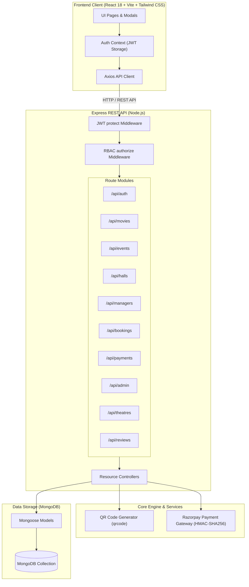
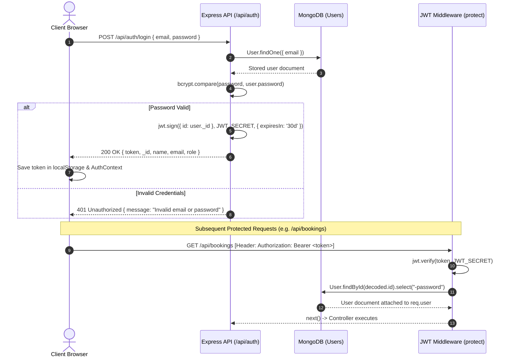
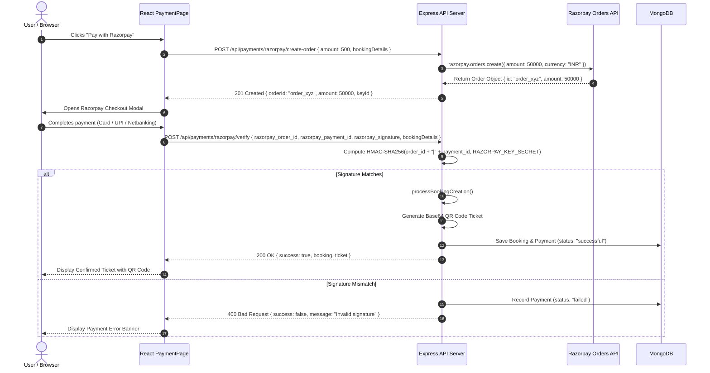

# 🎪 Hyper Local Event Hub

> **A Comprehensive, Production-Ready MERN Stack Platform for Local Entertainment, Movie Ticketing, Banquet Hall Reservations, and Professional Event Manager Booking with Automated QR Passports and Razorpay Test Mode Payments.**

[](https://react.dev/)
[](https://nodejs.org/)
[](https://expressjs.com/)
[](https://reactjs.org/)
[](https://vitejs.dev/)
[](https://tailwindcss.com/)
[](https://www.mongodb.com/)
[](https://razorpay.com/)
[](LICENSE)

---

## 📑 Table of Contents

1. [📌 Project Overview](#-project-overview)
2. [✨ Key Features](#-key-features)
3. [🛠️ Technology Stack](#️-technology-stack)
4. [📐 Frontend & Backend Architecture](#-frontend--backend-architecture)
5. [📁 Complete Folder Structure](#-complete-folder-structure)
6. [🚀 Installation & Setup Guide](#-installation--setup-guide)
7. [🔑 Environment Variables Reference](#-environment-variables-reference)
8. [🗄️ MongoDB Schemas & Data Models](#️-mongodb-schemas--data-models)
9. [🔐 Authentication & Security Architecture](#-authentication--security-architecture)
10. [👥 User Roles & Access Control (RBAC)](#-user-roles--access-control-rbac)
11. [🎬 Movie Booking & Seat Matrix Engine](#-movie-booking--seat-matrix-engine)
12. [🎟️ Event Booking & Live Inventory Engine](#️-event-booking--live-inventory-engine)
13. [🏛️ Banquet Hall & Venue Reservation](#️-banquet-hall--venue-reservation)
14. [🧑‍💼 Event Manager Hiring System](#-event-manager-hiring-system)
15. [⭐ Customer Review & Rating Engine](#-customer-review--rating-engine)
16. [💳 Payment Gateway & Razorpay Test Mode Flow](#-payment-gateway--razorpay-test-mode-flow)
17. [📊 Admin & Role Dashboards](#-admin--role-dashboards)
18. [🔌 Complete REST API Endpoints Specification](#-complete-rest-api-endpoints-specification)
19. [🧪 Testing & Seeding Utilities](#-testing--seeding-utilities)
20. [🛠️ Troubleshooting & FAQ](#️-troubleshooting--faq)
21. [👥 Demo Credentials Reference](#-demo-credentials-reference)
22. [📄 Documentation Links](#-documentation-links)

---

## 📌 Project Overview

**Hyper Local Event Hub** is an integrated full-stack MERN (MongoDB, Express.js, React, Node.js) web application architected to decentralize and unify local community entertainment, live event hosting, multiplex movie ticketing, banquet hall leasing, and freelance event planner hiring.

### Problem It Solves
Traditional platforms isolate movie ticketing, live event passes, venue reservations, and event planner directories into disconnected silos. **Hyper Local Event Hub** brings these four hyper-local commerce sectors under a single modern application with:
- **Unified Discovery**: Browse upcoming blockbusters, concerts, college festivals, comedy clubs, wedding halls, and event coordinators based on city and tags.
- **Seat-Level Concurrency Control**: Interactive multiplex seating layouts with live duplicate-booking prevention and VIP tiering.
- **Tamper-Proof QR Tickets**: Instant Base64 QR code generation containing cryptographic ticket data for on-site scanning and redemption.
- **Verified Payment Processing**: Built-in Razorpay checkout supporting Card, UPI, Netbanking, and Wallets with server-side HMAC-SHA256 signature verification and graceful demo fallbacks.
- **Role-Centric Portals**: Six distinct role profiles ranging from general customers to event organizers, venue owners, theatre managers, and platform super-administrators.

---

## ✨ Key Features

### 👤 Multi-Role User Management
- Secure user registration and login with bcrypt password hashing (10 salt rounds).
- Stateless JSON Web Token (JWT) authorization passed via HTTP Bearer headers.
- Support for 6 distinct roles: `user`, `organizer`, `hallOwner`, `theatreOwner`, `manager`, and `admin`.
- Role verification middleware with automatic role normalization.
- Customer wishlist and saved favorites for upcoming events.

### 🎬 Interactive Movie Ticket Booking
- Multiplex showtime scheduling, multiple screens, and theatre listings.
- Visual seat selection grid with VIP Recliner (Row A & B) and Standard Tier pricing.
- Concurrency-safe seat locks: prevents multiple users from booking the same seat.
- Real-time seat availability updates and cancellation seat restoration.

### 🎟️ Event Discovery & Registration
- Category-based filtering: **Concerts**, **Sports Matches**, **Stand-up Comedy**, **College Fests**, and **Festivals**.
- Date-range and city-based querying with live inventory counters.
- Automatic decrement of available passes upon ticket purchase and increment upon cancellation.
- Event organizer attribution and administrative approval workflows.

### 🏛️ Banquet Hall & Venue Reservation
- High-capacity banquet halls, hotel lawns, and auditorium listings.
- Hourly rental and per-night pricing with comprehensive amenity tags (AC, Catering, Audio-Visual, Parking).
- Availability slot calendars and direct venue booking.
- Venue owner host portals with listing creation and pending review statuses.

### 🧑‍💼 Certified Event Manager Hiring
- Directory of professional local event coordinators and wedding planners.
- Profiles featuring core expertise, portfolio bios, contact channels, and daily fees.
- Integrated booking system for hiring supervisors for private and corporate gatherings.

### 🎟️ Cryptographic QR Code Digital Tickets
- Automatic Base64 QR code ticket generation using the `qrcode` engine upon confirmed payment.
- Encodes Ticket ID, User ID, Show/Venue details, Seat Numbers, Total Price, and Timestamp.
- Digital ticket preview modal with one-click print and save capabilities.

### 💳 Razorpay Test Mode Payment Gateway
- Complete order lifecycle: Order Creation (`/api/payments/razorpay/create-order`), Client Checkout Modal, and Signature Verification (`/api/payments/razorpay/verify`).
- Cryptographic HMAC-SHA256 verification using Razorpay Key Secret.
- Seamless developer test mode fallback if external API keys are not supplied.
- Transaction ledger tracking user, booking, amount, provider, and payment statuses.

### ⭐ Polymorphic Review & Rating System
- Flexible review model supporting ratings (1 to 5 stars) and comments across movies, events, halls, and managers.
- Target-based query filters for loading reviews on item detail pages.
- Admin review monitoring and moderation tools.

### 📊 Business & Admin Dashboards
- Super-Admin metrics: Total registered users, active events, registered halls, gross revenue, and pending host/venue approvals.
- Dedicated Organizer dashboard for tracking attendee counts and event revenues.
- Theatre & Hall Owner dashboards for managing screens, pricing, and reservation logs.

---

## 🛠️ Technology Stack

| Layer | Technology | Version | Purpose |
|---|---|---|---|
| **Frontend Framework** | React.js | v18.3.1 | Component-driven Single Page Application (SPA) |
| **Frontend Build Tool** | Vite | v5.4.0 | Fast HMR dev server and production bundler |
| **Styling & CSS** | Tailwind CSS | v3.4.5 | Modern utility-first responsive styling |
| **CSS Processing** | PostCSS & Autoprefixer | v8.4.38 | Automated browser prefixing |
| **Animations** | GSAP (GreenSock) | v3.15.0 | High-performance page transitions and UI reveals |
| **Routing** | React Router DOM | v6.14.1 | Declarative client-side routing & route guards |
| **HTTP Client** | Axios | v1.5.1 | REST API communication with Bearer token injection |
| **Backend Runtime** | Node.js | v18.0.0+ | Server-side JavaScript runtime |
| **Web Framework** | Express.js | v4.18.2 | RESTful API server and route handling |
| **Database** | MongoDB | v7.0+ | NoSQL document database |
| **ODM** | Mongoose | v7.5.0 | Schema validation, hooks, and model relations |
| **Authentication** | JWT (`jsonwebtoken`) | v9.0.1 | Stateless authentication tokens |
| **Password Security** | `bcryptjs` | v2.4.3 | Salt generation & password hashing |
| **Payment Gateway** | `razorpay` | v2.9.8 | Payment order generation & verification |
| **QR Code Engine** | `qrcode` | v1.5.1 | Base64 ticket QR code generation |
| **Logging & Utility** | `morgan`, `cors`, `dotenv` | Latest | HTTP logging, CORS security, and environment parsing |
| **Dev Tooling** | `nodemon` | v3.1.14 | Automatic backend restart on file modification |

---

## 📐 Frontend & Backend Architecture



### Frontend Architecture Details
- **Entry Point**: `src/main.jsx` initializes React root and loads `src/index.css`.
- **State & Context**: `src/context/AuthContext.jsx` manages user login state, token persistence in `localStorage`, role resolution, and login/logout actions.
- **Route Protection**: `src/components/ProtectedRoute.jsx` intercepts unauthorized routes, verifying both active login status and role privileges before rendering protected outlets.
- **API Proxy**: `frontend/vite.config.js` proxies all `/api` requests to `http://localhost:4000` to eliminate cross-origin issues during local development.

### Backend Architecture Details
- **Entry Point**: `backend/src/server.js` boots Express, connects to MongoDB via `src/config/db.js`, mounts middleware (JSON parser, CORS, Morgan logger), and attaches all routes under `/api`.
- **Security Middlewares**: 
  - `protect`: Extracts `Bearer <token>` from headers, verifies token with `JWT_SECRET`, and populates `req.user` without password.
  - `authorize(...roles)`: Normalizes user role and ensures the requesting user belongs to the allowed role set (with automatic bypass for super-admins).
- **Concurrency & Transaction Safety**: Seat selection validates unbooked status before pushing into showtime `bookedSeats`, preventing overbooking.

---

## 📁 Complete Folder Structure

```text
minnor/
├── README.md                      # Comprehensive project documentation
├── ARCHITECTURE.md                # System architecture, Mermaid & ER diagrams
├── API_KEYS_GUIDE.md              # Detailed API key provisioning instructions
├── .gitignore                     # Git ignore rules for node_modules and .env
│
├── backend/
│   ├── .env                       # Backend environment file (ignored by git)
│   ├── .env.example               # Template for environment variables
│   ├── package.json               # Backend dependencies & script definitions
│   ├── package-lock.json          # Locked dependency tree
│   ├── nodemon.json               # Nodemon watcher configuration
│   ├── seeder.js                  # Basic seed script for initial testing
│   ├── seedDemoData.js            # Comprehensive Bhopal demo dataset seeder
│   ├── test_razorpay_flow.js      # Automated Razorpay integration test runner
│   │
│   └── src/
│       ├── server.js              # Express app bootstrap & listener
│       │
│       ├── config/
│       │   └── db.js              # Mongoose MongoDB connection handler
│       │
│       ├── middleware/
│       │   └── auth.js            # protect, authorize, and normalizeRole guards
│       │
│       ├── models/
│       │   ├── User.js            # User accounts & RBAC roles
│       │   ├── Movie.js           # Movie listings & showtimes
│       │   ├── Theatre.js         # Multiplexes, screens & seat tiers
│       │   ├── Event.js           # Live events, categories & inventory
│       │   ├── Hall.js            # Banquet halls & rental venues
│       │   ├── Manager.js         # Event manager portfolios
│       │   ├── Booking.js         # Confirmed bookings & QR payload
│       │   ├── Payment.js         # Payment transaction ledger
│       │   ├── Review.js          # Polymorphic ratings & comments
│       │   └── PlatformSetting.js # Global system configurations
│       │
│       ├── routes/
│       │   ├── index.js           # Central route aggregator
│       │   ├── authRoutes.js      # Register & login routes
│       │   ├── userRoutes.js      # Profile, wishlist & user administration
│       │   ├── movieRoutes.js     # Movie catalog & showtime endpoints
│       │   ├── theatreRoutes.js   # Multiplex screen & venue endpoints
│       │   ├── eventRoutes.js     # Live event listings & creator endpoints
│       │   ├── hallRoutes.js      # Hall listings & owner endpoints
│       │   ├── managerRoutes.js   # Event manager directory endpoints
│       │   ├── bookingRoutes.js   # Booking engine & ticket retrieval
│       │   ├── paymentRoutes.js   # Razorpay orders, verification & records
│       │   ├── reviewRoutes.js    # Review submission & retrieval
│       │   ├── adminRoutes.js     # Admin analytics, approvals & revenue
│       │   ├── businessRoutes.js  # Host/Organizer metrics & customers
│       │   └── platformSettingsRoutes.js # Platform configuration controls
│       │
│       ├── controllers/
│       │   ├── authController.js
│       │   ├── userController.js
│       │   ├── movieController.js
│       │   ├── theatreController.js
│       │   ├── eventController.js
│       │   ├── hallController.js
│       │   ├── managerController.js
│       │   ├── bookingController.js
│       │   ├── paymentController.js
│       │   ├── reviewController.js
│       │   ├── adminController.js
│       │   ├── businessController.js
│       │   └── platformSettingsController.js
│       │
│       └── utils/
│           ├── generateToken.js   # JWT signature generator
│           ├── generateQR.js      # Base64 QR code ticket generation
│           └── razorpay.js        # Razorpay SDK initialization & signature check
│
└── frontend/
    ├── index.html                 # HTML5 template with viewport configuration
    ├── vite.config.js             # Vite configuration with /api reverse proxy
    ├── tailwind.config.js         # Tailwind theme & color configurations
    ├── postcss.config.js          # PostCSS processor config
    ├── package.json               # Frontend dependencies & scripts
    ├── .env                       # Frontend environment file (ignored by git)
    ├── .env.example               # Template for frontend environment variables
    │
    └── src/
        ├── main.jsx               # React DOM render entry point
        ├── App.jsx                # Main layout, route definitions & AuthProvider
        ├── index.css              # Tailwind directives & global styling
        │
        ├── api/
        │   └── client.js          # Axios instance configured with auth headers
        │
        ├── context/
        │   └── AuthContext.jsx    # React Context for authentication & user state
        │
        ├── components/
        │   ├── Navbar.jsx         # Navigation bar with responsive role links
        │   ├── Footer.jsx         # Platform footer & copyright
        │   ├── ProtectedRoute.jsx # Role-aware route guard component
        │   └── AnimatedReveal.jsx # GSAP animation reveal wrapper
        │
        └── pages/
            ├── HomePage.jsx           # Landing page with search, filters & highlights
            ├── MovieBookingPage.jsx   # Movie listings & interactive seat layout
            ├── EventsPage.jsx         # Event discovery & pass selection
            ├── HallBookingPage.jsx    # Banquet hall listings & reservation form
            ├── HireManagerPage.jsx    # Event manager directory & hire modal
            ├── PaymentPage.jsx        # Checkout review & Razorpay payment trigger
            ├── Login.jsx              # User login screen
            ├── Register.jsx           # User registration screen
            ├── NotFoundPage.jsx       # 404 error page
            │
            ├── user/
            │   ├── UserDashboardPage.jsx # Customer overview
            │   ├── UserBookingsPage.jsx  # Digital ticket history & QR codes
            │   ├── UserEventsPage.jsx    # Registered events
            │   └── UserReviewsPage.jsx   # Past submitted reviews
            │
            ├── admin/
            │   ├── AdminDashboardPage.jsx # Super-admin analytics & charts
            │   ├── AdminUsersPage.jsx     # User management & role modification
            │   ├── AdminManagersPage.jsx  # Manager approval queue
            │   ├── AdminEventsPage.jsx    # Event moderation
            │   ├── AdminMoviesPage.jsx    # Movie catalog control
            │   ├── AdminHallsPage.jsx     # Venue approval & management
            │   └── AdminPaymentsPage.jsx  # Payment auditing ledger
            │
            ├── organizer/
            │   └── OrganizerDashboardPage.jsx # Live attendee & event revenue metrics
            │
            ├── hall/
            │   └── HallOwnerDashboardPage.jsx # Hall listing & booking schedule
            │
            ├── theatre/
            │   └── TheatreOwnerDashboardPage.jsx # Screens, movies & showtimes
            │
            └── manager/
                ├── ManagerDashboardPage.jsx   # Event manager profile & schedule
                └── ManagerBookingsPage.jsx    # Client hiring requests
```

---

## 🚀 Installation & Setup Guide

### 1. Prerequisites
Ensure the following tools are installed on your workstation:
- **Node.js**: `v18.0.0` or higher ([Download Node.js](https://nodejs.org/))
- **npm**: `v9.0.0` or higher (bundled with Node.js)
- **MongoDB**: Local MongoDB community service running on port `27017` OR a free cloud connection URI from [MongoDB Atlas](https://www.mongodb.com/cloud/atlas).
- **Git**: For cloning the repository.

---

### 2. Clone the Repository
```bash
git clone https://github.com/your-username/minnor.git
cd minnor
```

---

### 3. Backend Setup & Configuration

1. Navigate to the backend directory:
   ```bash
   cd backend
   ```

2. Install all required dependencies:
   ```bash
   npm install
   ```

3. Create your `.env` configuration file from the template:
   ```bash
   cp .env.example .env
   ```

4. Open `backend/.env` in your code editor and verify/adjust the parameters:
   ```env
   PORT=4000
   NODE_ENV=development
   MONGO_URI=mongodb://127.0.0.1:27017/minnor
   JWT_SECRET=super_secret_jwt_key_hyper_local_event_hub_2026
   RAZORPAY_KEY_ID=rzp_test_your_key_id_here
   RAZORPAY_KEY_SECRET=your_razorpay_secret_key_here
   ```

5. Seed the database with demonstration data:
   ```bash
   # Option A: Fast basic seeder (Creates Admin, 2 Movies, 2 Events, 2 Halls, 2 Managers)
   npm run seed

   # Option B: Rich Bhopal demonstration dataset (Multiplexes, Seating tiers, Multi-role accounts)
   npm run seed:demo
   ```

6. Start the backend development server:
   ```bash
   npm run dev
   ```
   *The backend REST API server will run at `http://localhost:4000`.*

---

### 4. Frontend Setup & Configuration

1. Open a **new terminal window** and navigate to the frontend directory:
   ```bash
   cd frontend
   ```

2. Install frontend dependencies:
   ```bash
   npm install
   ```

3. Create the frontend `.env` file:
   ```bash
   cp .env.example .env
   ```

4. Configure your frontend `.env`:
   ```env
   VITE_RAZORPAY_KEY_ID=rzp_test_your_key_id_here
   ```
   *(Note: Never place `RAZORPAY_KEY_SECRET` in the frontend directory).*

5. Start the Vite React development server:
   ```bash
   npm run dev
   ```
   *The frontend client will open at `http://localhost:3000`.*

---

## 🔑 Environment Variables Reference

### Backend Environment Variables (`backend/.env`)

| Variable Name | Required | Default / Example Value | Description |
|---|---|---|---|
| `PORT` | Yes | `4000` | Port on which the Express REST API server listens. |
| `NODE_ENV` | Yes | `development` | Runtime environment (`development` or `production`). |
| `MONGO_URI` | Yes | `mongodb://127.0.0.1:27017/minnor` | MongoDB connection URI string (Local or MongoDB Atlas). |
| `JWT_SECRET` | Yes | `super_secret_jwt_key_2026` | Cryptographic secret key used to sign and verify user JWT tokens. |
| `RAZORPAY_KEY_ID` | Optional | `rzp_test_xxxxxxxxxxxxxx` | Razorpay public Key ID for initiating test transactions. |
| `RAZORPAY_KEY_SECRET` | Optional | `xxxxxxxxxxxxxxxxxxxxxxxx` | Razorpay secret key used to verify HMAC-SHA256 signatures. |
| `CLOUDINARY_CLOUD_NAME` | Optional | `your_cloud_name` | Cloudinary account name for cloud poster/image uploads. |
| `CLOUDINARY_API_KEY` | Optional | `123456789012345` | Cloudinary API Key. |
| `CLOUDINARY_API_SECRET` | Optional | `your_api_secret` | Cloudinary API Secret. |

> [!TIP]
> **Generating a Secure JWT Secret**:
> You can generate a cryptographically strong 256-bit random key in your terminal with:
> ```bash
> node -e "console.log(require('crypto').randomBytes(32).toString('hex'))"
> ```

### Frontend Environment Variables (`frontend/.env`)

| Variable Name | Required | Default / Example Value | Description |
|---|---|---|---|
| `VITE_RAZORPAY_KEY_ID` | Optional | `rzp_test_xxxxxxxxxxxxxx` | Razorpay Key ID used by the browser to mount Razorpay Checkout. |

---

## 🗄️ MongoDB Schemas & Data Models

The system architecture utilizes **10 distinct Mongoose models** to represent all business entities:

### 1. `User` Model (`backend/src/models/User.js`)
Handles identity, credentials, roles, and user state.
```javascript
{
  name: { type: String, required: true },
  email: { type: String, required: true, unique: true, lowercase: true },
  password: { type: String, required: true },
  role: {
    type: String,
    enum: ['user', 'eventManager', 'manager', 'organizer', 'hotelOwner', 'hallOwner', 'hall_owner', 'theatreOwner', 'admin'],
    default: 'user'
  },
  city: { type: String },
  phone: { type: String },
  status: { type: String, enum: ['pending', 'approved', 'suspended'], default: 'approved' },
  favorites: [{ type: mongoose.Schema.Types.ObjectId, ref: 'Event' }],
  wishlist: [{ type: mongoose.Schema.Types.ObjectId, ref: 'Event' }]
}
```
*Pre-save Hook*: Automatically generates salt with 10 rounds and hashes passwords via `bcrypt.hash`.  
*Instance Method*: `matchPassword(enteredPassword)` compares plaintext against stored hash.

### 2. `Movie` Model (`backend/src/models/Movie.js`)
Manages movie catalog information, showtimes, and booked seats.
```javascript
{
  owner: { type: mongoose.Schema.Types.ObjectId, ref: 'User' },
  title: { type: String, required: true },
  description: { type: String, required: true },
  genre: { type: String },
  duration: { type: Number },
  language: { type: String },
  posterUrl: { type: String },
  images: [{ type: String }],
  releaseDate: { type: Date },
  showtimes: [{
    time: String,
    price: Number,
    availableSeats: Number,
    screen: String,
    date: Date,
    theatreId: { type: mongoose.Schema.Types.ObjectId, ref: 'Theatre' },
    theatreName: String,
    bookedSeats: [{ type: String }] // e.g. ["A1", "A2", "B5"]
  }],
  city: { type: String, default: 'Bhopal' },
  theatreName: { type: String },
  theatre: { type: mongoose.Schema.Types.ObjectId, ref: 'Theatre' },
  rating: { type: Number, default: 4.2 },
  category: { type: String, default: 'movie' },
  published: { type: Boolean, default: true }
}
```

### 3. `Theatre` Model (`backend/src/models/Theatre.js`)
Defines physical multiplex venues, screen specifications, and seat tiers.
```javascript
{
  name: { type: String, required: true },
  city: { type: String, required: true },
  address: { type: String, required: true },
  owner: { type: mongoose.Schema.Types.ObjectId, ref: 'User', required: true },
  screens: [{
    name: { type: String, required: true },
    capacity: { type: Number, default: 80 },
    rows: { type: Number, default: 8 },
    cols: { type: Number, default: 10 },
    seatTiers: [{
      name: { type: String, default: 'Standard' },
      price: { type: Number, default: 250 },
      rows: [{ type: String }]
    }]
  }],
  amenities: [{ type: String }],
  description: { type: String },
  rating: { type: Number, default: 4.5 },
  status: { type: String, enum: ['active', 'inactive', 'maintenance'], default: 'active' },
  imageUrl: { type: String }
}
```

### 4. `Event` Model (`backend/src/models/Event.js`)
Handles live events, concerts, comedy specials, and inventory.
```javascript
{
  title: { type: String, required: true },
  description: { type: String, required: true },
  category: { 
    type: String, 
    enum: ['concert', 'sports', 'comedy', 'college', 'festival', 'movie', 'hotel', 'theatre'], 
    default: 'concert' 
  },
  city: { type: String, required: true },
  venue: { type: String },
  startDate: { type: Date, required: true },
  endDate: { type: Date },
  ticketPrice: { type: Number, required: true },
  imageUrl: { type: String },
  bannerUrl: { type: String },
  galleryImages: [{ type: String }],
  organizer: { type: mongoose.Schema.Types.ObjectId, ref: 'User' },
  seatsAvailable: { type: Number, default: 200 },
  capacity: { type: Number, default: 200 },
  time: { type: String },
  published: { type: Boolean, default: true },
  approved: { type: Boolean, default: false },
  featured: { type: Boolean, default: false },
  analytics: {
    views: { type: Number, default: 0 },
    bookings: { type: Number, default: 0 }
  }
}
```

### 5. `Hall` Model (`backend/src/models/Hall.js`)
Models banquet venues, party halls, and meeting spaces.
```javascript
{
  name: { type: String, required: true },
  city: { type: String, required: true },
  address: { type: String, required: true },
  capacity: { type: Number, required: true },
  hourlyRate: { type: Number, required: true },
  pricePerNight: { type: Number },
  images: [{ type: String }],
  availability: [{ date: Date, slots: [String], booked: { type: Boolean, default: false } }],
  amenities: [{ type: String }],
  rooms: [{ type: String }],
  type: { type: String, enum: ['hotel', 'theatre', 'venue'], default: 'hotel' },
  owner: { type: mongoose.Schema.Types.ObjectId, ref: 'User' },
  approved: { type: Boolean, default: false },
  published: { type: Boolean, default: true },
  featured: { type: Boolean, default: false },
  rating: { type: Number, default: 4.6 },
  description: { type: String }
}
```

### 6. `Manager` Model (`backend/src/models/Manager.js`)
Professional event planner portfolios.
```javascript
{
  name: { type: String, required: true },
  city: { type: String, required: true },
  expertise: { type: String, required: true },
  pricePerEvent: { type: Number, required: true },
  rating: { type: Number, default: 4.8 },
  imageUrl: { type: String },
  bio: { type: String },
  reviews: [{ type: mongoose.Schema.Types.ObjectId, ref: 'Review' }],
  contact: { type: String }
}
```

### 7. `Booking` Model (`backend/src/models/Booking.js`)
The central transaction record uniting customers, items, seats, and digital tickets.
```javascript
{
  ticketId: { type: String, unique: true, sparse: true },
  user: { type: mongoose.Schema.Types.ObjectId, ref: 'User', required: true },
  itemType: { type: String, enum: ['movie', 'event', 'hall', 'manager'], default: 'movie' },
  event: { type: mongoose.Schema.Types.ObjectId, ref: 'Event' },
  movie: { type: mongoose.Schema.Types.ObjectId, ref: 'Movie' },
  theatre: { type: mongoose.Schema.Types.ObjectId, ref: 'Theatre' },
  hall: { type: mongoose.Schema.Types.ObjectId, ref: 'Hall' },
  manager: { type: mongoose.Schema.Types.ObjectId, ref: 'Manager' },
  date: { type: Date, required: true },
  showtime: { type: String },
  screen: { type: String },
  seats: [{
    seatNumber: String,
    price: Number,
    tier: String
  }],
  totalPrice: { type: Number, required: true },
  status: { type: String, enum: ['pending', 'confirmed', 'cancelled'], default: 'confirmed' },
  paymentStatus: { type: String, enum: ['pending', 'paid', 'failed'], default: 'paid' },
  qrCodeUrl: { type: String },
  payment: { type: mongoose.Schema.Types.ObjectId, ref: 'Payment' }
}
```

### 8. `Payment` Model (`backend/src/models/Payment.js`)
Cryptographic transaction audit trail.
```javascript
{
  user: { type: mongoose.Schema.Types.ObjectId, ref: 'User', required: true },
  booking: { type: mongoose.Schema.Types.ObjectId, ref: 'Booking' },
  amount: { type: Number, required: true },
  provider: { type: String, default: 'Razorpay' },
  status: { type: String, enum: ['pending', 'successful', 'failed'], default: 'pending' },
  paymentId: { type: String },
  orderId: { type: String },
  signature: { type: String }
}
```

### 9. `Review` Model (`backend/src/models/Review.js`)
Polymorphic customer feedback model.
```javascript
{
  author: { type: mongoose.Schema.Types.ObjectId, ref: 'User', required: true },
  targetType: { type: String, enum: ['movie', 'event', 'hall', 'manager'], required: true },
  target: { type: mongoose.Schema.Types.ObjectId, required: true, refPath: 'targetType' },
  rating: { type: Number, required: true, min: 1, max: 5 },
  comment: { type: String }
}
```

### 10. `PlatformSetting` Model (`backend/src/models/PlatformSetting.js`)
Global settings document for administrative configuration.
```javascript
{
  settings: { type: mongoose.Schema.Types.Mixed, default: {} }
}
```

---

## 🔐 Authentication & Security Architecture

The platform implements a stateless JWT-based authentication architecture:



---

## 👥 User Roles & Access Control (RBAC)

The system features granular Role-Based Access Control managed via `backend/src/middleware/auth.js`.

### Role Normalization Logic
To maintain backwards compatibility across frontends and seeded datasets, the backend normalizes role strings via `normalizeRole`:
- `['user', 'customer']` $\rightarrow$ `user`
- `['organizer']` $\rightarrow$ `organizer`
- `['manager', 'eventManager']` $\rightarrow$ `manager`
- `['hall_owner', 'hallOwner', 'hotelOwner', 'theatreOwner']` $\rightarrow$ `hall_owner`
- `['admin']` $\rightarrow$ `admin` (Unrestricted access across all endpoints)

### Role Permissions Matrix

| Platform Module | `user` | `organizer` | `hallOwner` | `theatreOwner` | `manager` | `admin` |
|---|:---:|:---:|:---:|:---:|:---:|:---:|
| **Public Browsing (Movies, Events, Halls, Managers)** | ✅ | ✅ | ✅ | ✅ | ✅ | ✅ |
| **Book Tickets & Pay via Razorpay** | ✅ | ✅ | ✅ | ✅ | ✅ | ✅ |
| **View Own Bookings & Digital QR Passes** | ✅ | ✅ | ✅ | ✅ | ✅ | ✅ |
| **Submit Ratings & Reviews** | ✅ | ✅ | ✅ | ✅ | ✅ | ✅ |
| **Create & Manage Live Events** | ❌ | ✅ | ❌ | ❌ | ✅ | ✅ |
| **Register & Manage Banquet Halls** | ❌ | ❌ | ✅ | ✅ | ❌ | ✅ |
| **Create Multiplex Screens & Showtimes** | ❌ | ❌ | ❌ | ✅ | ❌ | ✅ |
| **Manage Manager Directory Listings** | ❌ | ✅ | ❌ | ❌ | ❌ | ✅ |
| **Approve / Reject Pending Listings** | ❌ | ❌ | ❌ | ❌ | ❌ | ✅ |
| **User Role & Status Management** | ❌ | ❌ | ❌ | ❌ | ❌ | ✅ |
| **Platform Revenue & Analytics Auditing** | ❌ | ❌ | ❌ | ❌ | ❌ | ✅ |

---

## 🎬 Movie Booking & Seat Matrix Engine

Movie ticketing in **Hyper Local Event Hub** is built with concurrency control:

1. **Multiplex & Showtime Selection**: The user selects a movie, date, and preferred showtime slot (e.g., `07:00 PM` in `Screen 1`).
2. **Visual Seat Matrix**:
   - **Row A & B**: Classified as **VIP Recliner Loungers** (Base price + ₹100).
   - **Row C to H**: Classified as **Standard Club Seats** (Base price, e.g., ₹250).
   - Already booked seats are visually disabled based on the showtime's `bookedSeats` array.
3. **Seat Concurrency Validation**:
   ```javascript
   // backend/src/controllers/bookingController.js
   const alreadyBooked = requestedSeatNumbers.filter((s) => matchedShowtime.bookedSeats.includes(s));
   if (alreadyBooked.length > 0) {
     const err = new Error(`Seat(s) ${alreadyBooked.join(', ')} are already booked.`);
     err.statusCode = 400;
     throw err;
   }
   ```
4. **Atomic Booking Confirmation**:
   - `bookedSeats` is updated with the selected seat numbers.
   - `availableSeats` is decremented by the seat count.
   - A Base64 QR code ticket is generated immediately containing the seat identifiers and show details.
5. **Seat Restoration on Cancellation**:
   - If a booking is cancelled (`PUT /api/bookings/:id/cancel`), the seats are filtered out from `bookedSeats` and `availableSeats` is restored.

---

## 🎟️ Event Booking & Live Inventory Engine

Event ticketing caters to concerts, college festivals, comedy clubs, and sports tournaments:

1. **Category Filtering**: Real-time filtering by category (`concert`, `sports`, `comedy`, `college`, `festival`).
2. **Pass Inventory Verification**:
   - The booking controller verifies that `event.seatsAvailable >= requestedCount`.
   - If passes are depleted, an HTTP 400 error is returned.
3. **Atomic Inventory Decrement**:
   ```javascript
   await Event.findByIdAndUpdate(eventId, {
     $inc: {
       'analytics.bookings': 1,
       seatsAvailable: -requestedCount,
     },
   });
   ```
4. **Digital Pass QR Issuance**: Each event attendee receives a unique Base64 verification pass with `ticketId` formatted as `TKT-<TIMESTAMP>-<RANDOM>`.

---

## 🏛️ Banquet Hall & Venue Reservation

The venue leasing engine enables users to book banquet halls, luxury hotel lawns, and conference venues:

1. **Venue Details & Capacity**: View indoor/outdoor capacities, hourly rates, per-night rates, address, and amenities (Catering, Stage, High-Speed WiFi, Sound Setup).
2. **Slot Selection**: Choose rental dates and reserve venues for personal ceremonies or corporate conferences.
3. **Owner Approvals & Moderation**: Newly listed halls by `hallOwner` users enter a `pending` state until verified by the platform super-admin (`PUT /api/admin/halls/:id/status`).

---

## 🧑‍💼 Event Manager Hiring System

For users seeking professional planners to coordinate weddings, corporate galas, or concerts:

1. **Coordinator Directory**: Browse certified managers with details on their city, years of experience, expertise, and daily rates.
2. **Direct Booking Request**: Select date, event type, and special supervision requests.
3. **Client Contract Generation**: Creates a confirmed booking linked to the manager profile with full contact details and date scheduling.

---

## ⭐ Customer Review & Rating Engine

The platform features a polymorphic review engine where any customer can review movies, events, halls, or managers:

- **Endpoint**: `POST /api/reviews`
- **Request Body**:
  ```json
  {
    "targetType": "movie",
    "target": "654c123456789abcdef01234",
    "rating": 5,
    "comment": "Incredible Dolby Atmos sound and ultra-comfortable recliner seating!"
  }
  ```
- **Query Filter**: `GET /api/reviews?targetType=movie&target=654c123456789abcdef01234` returns only reviews for that specific resource with populated author names.

---

## 💳 Payment Gateway & Razorpay Test Mode Flow

The application provides an enterprise-grade payment flow utilizing the **Razorpay Test Mode API** with cryptographic signature checks:



### Signature Verification Code Pattern
```javascript
// backend/src/utils/razorpay.js
const crypto = require('crypto');

const verifyRazorpaySignature = ({ orderId, paymentId, signature }) => {
  const secret = process.env.RAZORPAY_KEY_SECRET;
  const expectedSignature = crypto
    .createHmac('sha256', secret)
    .update(`${orderId}|${paymentId}`)
    .digest('hex');
    
  return expectedSignature === signature;
};
```

### Developer Test Mode & Demo Fallback
If `RAZORPAY_KEY_ID` or `RAZORPAY_KEY_SECRET` are not set or contain placeholder text:
- The server automatically switches to **Mock Test Mode**.
- It generates a valid simulated order and pre-computed HMAC signature.
- Unit tests and UI flows succeed seamlessly without requiring live payment credentials.

---

## 📊 Admin & Role Dashboards

### 1. Super-Admin Dashboard (`/admin/*`)
- **Live Statistics Overview**: Total registered users, active events, registered venues, total bookings, and pending approval queues.
- **Listing Approvals**: Approve or reject newly registered events (`PUT /api/admin/events/:id/approve`) and banquet halls (`PUT /api/admin/halls/:id/status`).
- **User & Role Administration**: Update user statuses (`approved`, `suspended`) or promote users to managers/organizers.
- **Revenue Audit Ledger**: View all confirmed transactions and calculate platform-wide gross revenue.

### 2. Organizer Dashboard (`/organizer/dashboard`)
- Real-time booking counts and attendee check-in summaries.
- Revenue generated per hosted concert or comedy night.
- Fast event listing creation form.

### 3. Hall Owner Dashboard (`/hall-owner/dashboard`)
- Listing overview of registered halls, pricing, and amenities.
- Booking reservations calendar and customer rental logs.

### 4. Theatre Owner Dashboard (`/theatre-owner/dashboard`)
- Screen capacity configurations and movie showtime assignment.
- Seat occupancy rates per showtime.

### 5. Event Manager Dashboard (`/event-manager/dashboard`)
- Client consultation requests and booking dates.
- Profile and expertise management.

---

## 🔌 Complete REST API Endpoints Specification

### 🔐 Authentication (`/api/auth`)
| Method | Path | Auth Level | Description |
|---|---|---|---|
| `POST` | `/api/auth/register` | Public | Register new user account with role |
| `POST` | `/api/auth/login` | Public | Authenticate user & return JWT token |

---

### 👤 User Profile & Wishlist (`/api/users`)
| Method | Path | Auth Level | Description |
|---|---|---|---|
| `GET` | `/api/users/profile` | Protected (`user`) | Retrieve current user profile |
| `PUT` | `/api/users/profile` | Protected (`user`) | Update current user profile info |
| `GET` | `/api/users/wishlist` | Protected (`user`) | Get user saved event wishlist |
| `POST` | `/api/users/wishlist` | Protected (`user`) | Add event to user wishlist |
| `DELETE`| `/api/users/wishlist/:id` | Protected (`user`) | Remove event from wishlist |
| `GET` | `/api/users` | Protected (`admin`) | List all registered users |
| `PUT` | `/api/users/:id/status` | Protected (`admin`) | Update user status (`approved`, `suspended`) |
| `PUT` | `/api/users/:id/role` | Protected (`admin`) | Update user role |
| `DELETE`| `/api/users/:id` | Protected (`admin`) | Delete user account |

---

### 🎬 Movies & Showtimes (`/api/movies`)
| Method | Path | Auth Level | Description |
|---|---|---|---|
| `GET` | `/api/movies` | Public | List all published movies (with search & city filter) |
| `GET` | `/api/movies/me` | Protected (Host/Admin) | List movies managed by authenticated user |
| `GET` | `/api/movies/:id` | Public | Get single movie details with showtimes and booked seats |
| `POST` | `/api/movies` | Protected (Host/Admin) | Create a new movie listing |
| `PUT` | `/api/movies/:id` | Protected (Host/Admin) | Update movie details or showtimes |
| `DELETE`| `/api/movies/:id` | Protected (Host/Admin) | Delete movie listing |

---

### 🏛️ Multiplexes & Theatres (`/api/theatres`)
| Method | Path | Auth Level | Description |
|---|---|---|---|
| `GET` | `/api/theatres/public` | Public | List all active multiplexes in the city |
| `GET` | `/api/theatres/me` | Protected (TheatreOwner) | Get theatres owned by current user |
| `GET` | `/api/theatres/:id` | Public | Get single theatre specifications & screens |
| `POST` | `/api/theatres` | Protected (TheatreOwner) | Register a new theatre/multiplex |
| `PUT` | `/api/theatres/:id` | Protected (TheatreOwner) | Update theatre screens & seat tiers |
| `DELETE`| `/api/theatres/:id` | Protected (TheatreOwner) | Remove theatre listing |

---

### 🎟️ Live Events (`/api/events`)
| Method | Path | Auth Level | Description |
|---|---|---|---|
| `GET` | `/api/events` | Public | List events with category, city, and search filters |
| `GET` | `/api/events/me` | Protected (Organizer/Admin) | Get events created by logged-in organizer |
| `GET` | `/api/events/:id` | Public | Get event details, venue, time, and available passes |
| `POST` | `/api/events` | Protected (Organizer/Admin) | Create new live event |
| `PUT` | `/api/events/:id` | Protected (Organizer/Admin) | Update event details |
| `DELETE`| `/api/events/:id` | Protected (Organizer/Admin) | Delete event listing |

---

### 🏛️ Banquet Halls & Venues (`/api/halls`)
| Method | Path | Auth Level | Description |
|---|---|---|---|
| `GET` | `/api/halls` | Public | List approved banquet halls and venues |
| `GET` | `/api/halls/me` | Protected (HallOwner/Admin)| Get halls owned by authenticated user |
| `GET` | `/api/halls/:id` | Public | Get hall specifications, amenities, and rates |
| `POST` | `/api/halls` | Protected (HallOwner/Admin)| Register a new banquet hall |
| `PUT` | `/api/halls/:id` | Protected (HallOwner/Admin)| Update hall details |
| `DELETE`| `/api/halls/:id` | Protected (HallOwner/Admin)| Delete hall listing |

---

### 🧑‍💼 Event Managers (`/api/managers`)
| Method | Path | Auth Level | Description |
|---|---|---|---|
| `GET` | `/api/managers` | Public | List event managers with expertise & city filter |
| `GET` | `/api/managers/:id` | Public | Get manager profile, portfolio bio, and rates |
| `POST` | `/api/managers` | Protected (Organizer/Admin)| Register manager profile |
| `PUT` | `/api/managers/:id` | Protected (Organizer/Admin)| Update manager profile |
| `DELETE`| `/api/managers/:id` | Protected (`admin`) | Remove manager profile |

---

### 🎟️ Bookings & Digital Tickets (`/api/bookings`)
| Method | Path | Auth Level | Description |
|---|---|---|---|
| `GET` | `/api/bookings` | Protected (`user`) | Get booking history of logged-in user |
| `GET` | `/api/bookings/:id` | Protected (`user`) | Get booking details & verification QR code |
| `POST` | `/api/bookings` | Protected (`user`) | Create booking, validate seats & generate ticket |
| `PUT` | `/api/bookings/:id/cancel`| Protected (`user`) | Cancel booking & release reserved seats |

---

### 💳 Payments & Razorpay (`/api/payments`)
| Method | Path | Auth Level | Description |
|---|---|---|---|
| `GET` | `/api/payments/config` | Public | Get gateway configuration & Razorpay public Key ID |
| `POST` | `/api/payments/razorpay/create-order` | Protected (`user`) | Create Razorpay order in paise |
| `POST` | `/api/payments/razorpay/verify` | Protected (`user`) | Verify HMAC signature & issue confirmed ticket |
| `POST` | `/api/payments/razorpay/failed` | Protected (`user`) | Record failed or cancelled checkout attempts |
| `POST` | `/api/payments/create` | Protected (`user`) | Record direct transaction (legacy/mock) |
| `GET` | `/api/payments` | Protected (`user`/Admin) | Get payment history (Admin views all) |

---

### ⭐ Reviews & Feedback (`/api/reviews`)
| Method | Path | Auth Level | Description |
|---|---|---|---|
| `GET` | `/api/reviews` | Public | List reviews (filter by `targetType` & `target`) |
| `POST` | `/api/reviews` | Protected (`user`) | Submit review and star rating (1 to 5) |

---

### 🛡️ Super-Admin Management (`/api/admin`)
| Method | Path | Auth Level | Description |
|---|---|---|---|
| `GET` | `/api/admin/analytics` | Protected (`admin`) | Platform KPI statistics (Users, Events, Halls) |
| `PUT` | `/api/admin/events/:id/approve` | Protected (`admin`) | Approve pending live event listing |
| `PUT` | `/api/admin/events/:id/reject` | Protected (`admin`) | Reject live event listing |
| `PUT` | `/api/admin/halls/:id/status` | Protected (`admin`) | Update banquet hall approval status |
| `GET` | `/api/admin/bookings` | Protected (`admin`) | View all platform bookings |
| `GET` | `/api/admin/revenue` | Protected (`admin`) | View gross revenue and successful payments |
| `GET` | `/api/admin/reviews` | Protected (`admin`) | Moderate customer reviews |
| `GET` | `/api/admin/notifications` | Protected (`admin`) | Get summary count of pending approval items |

---

## 🧪 Testing & Seeding Utilities

The project includes pre-configured CLI testing utilities:

### 1. Run Automated Razorpay Integration Tests
To test the complete Razorpay test order creation, cryptographic HMAC-SHA256 signature verification, and automated Base64 QR ticket generation in the backend:
```bash
cd backend
npm run test:razorpay
```
**Test Workflow Verified**:
- `GET /api/payments/config` status check.
- Automatic registration and login of an ephemeral test customer.
- Order creation (`POST /api/payments/razorpay/create-order`).
- Signature verification with tamper detection test (`POST /api/payments/razorpay/verify`).
- Verification that ticket Base64 QR codes are properly generated and attached.

### 2. Database Seeding Commands
```bash
# Seed basic items (Admin, 2 movies, 2 events, 2 halls, 2 managers)
npm run seed

# Seed full demonstration dataset (Bhopal multiplexes, seating layouts, multi-role users)
npm run seed:demo
```

---

## 🛠️ Troubleshooting & FAQ

### 1. MongoDB Connection Error (`ECONNREFUSED 127.0.0.1:27017`)
- **Cause**: Local MongoDB service is not started.
- **Solution (Windows)**:
  - Open Windows Services (`services.msc`) and start **MongoDB Server**.
  - Or run `net start MongoDB` in an administrator command prompt.
- **Solution (Atlas Cloud)**:
  - Verify your `MONGO_URI` in `backend/.env`.
  - Ensure IP `0.0.0.0/0` is whitelisted in MongoDB Atlas under **Network Access**.

### 2. `Not authorized, token missing or invalid` (HTTP 401)
- **Cause**: The JWT token is missing, expired, or signed with a different `JWT_SECRET`.
- **Solution**:
  - Log out and log in again to generate a fresh token.
  - Verify that `JWT_SECRET` in `backend/.env` is consistent and not empty.

### 3. Port Already In Use (`EADDRINUSE: port 4000` or `3000`)
- **Cause**: A background Node or Vite process is already holding the port.
- **Solution (Windows PowerShell)**:
  ```powershell
  # Find process occupying port 4000
  Get-Process -Id (Get-NetTCPConnection -LocalPort 4000).OwningProcess | Stop-Process -Force
  
  # Find process occupying port 3000
  Get-Process -Id (Get-NetTCPConnection -LocalPort 3000).OwningProcess | Stop-Process -Force
  ```

### 4. Razorpay Signature Verification Failed (HTTP 400)
- **Cause**: `RAZORPAY_KEY_SECRET` in `backend/.env` does not match the secret of the Key ID generating the checkout in the frontend.
- **Solution**:
  - Ensure `RAZORPAY_KEY_ID` in `frontend/.env` matches `RAZORPAY_KEY_ID` in `backend/.env`.
  - Ensure `RAZORPAY_KEY_SECRET` is correctly copied from your Razorpay Dashboard (Settings $\rightarrow$ API Keys).
  - If testing without keys, leave the values blank or as default placeholders; the built-in mock fallback will handle verification automatically.

### 5. "Seat already booked" Error During Checkout
- **Cause**: Another user has selected or purchased the same seat for that specific showtime.
- **Solution**:
  - Refresh the Movie Booking Page to load the updated `bookedSeats` layout and select an unreserved seat.

---

## 👥 Demo Credentials Reference

When running `npm run seed:demo`, the database is populated with the following test accounts:

| Role | Name | Email | Password | Access Level |
|---|---|---|---|---|
| **Super Admin** | Super Admin | `admin@hyperlocal.com` | `AdminPassword@2026` | Full platform control, approvals, users & revenue analytics |
| **Theatre Owner** | Rajesh Verma | `theatre.admin@bhopalcinema.com` | `TheatreAdmin@2026` | Multiplex screens, showtimes & seat configurations |
| **Event Organizer** | Pooja Saxena | `organizer@bhopalevents.com` | `OrganizerPass@2026` | Live event creation, ticketing & attendee metrics |
| **Hall Owner** | Vikram Singh | `hallowner@bhopalvenues.com` | `HallOwnerPass@2026` | Banquet hall listings, rental rates & calendar |
| **Regular User** | Aman Sharma | `student.demo@bhopal.edu` | `StudentDemo@2026` | Customer seat booking, reviews & digital QR tickets |

*(If running the standard `npm run seed`, the default password for all test accounts is `password123` or `admin123`).*

---

## 📄 Documentation Links

- [📐 System Architecture, Component & ER Diagrams (ARCHITECTURE.md)](file:///c:/Users/HP/OneDrive/Desktop/minnor/ARCHITECTURE.md)
- [🔑 API Keys & Environment Variables Setup Guide (API_KEYS_GUIDE.md)](file:///c:/Users/HP/OneDrive/Desktop/minnor/API_KEYS_GUIDE.md)

---

## 📜 License

This minor project is built for educational and academic submission purposes under the MIT License.
