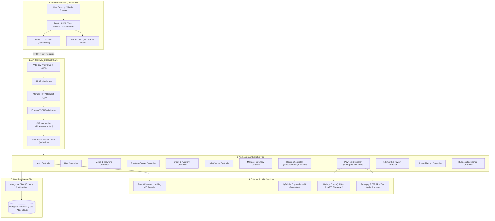
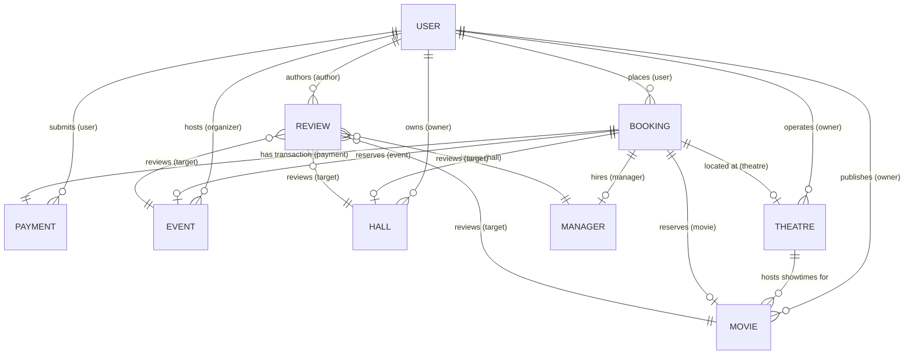

# 🎪 Hyper Local Event Hub

> **An Enterprise-Grade, Full-Stack MERN Platform Unifying Multiplex Movie Ticketing, Live Event Discovery, Banquet Hall Reservations, and Freelance Event Manager Hiring with Automated Cryptographic QR Passports and Razorpay Test Mode Payments.**

[](https://react.dev/)
[](https://nodejs.org/)
[](https://expressjs.com/)
[](https://reactjs.org/)
[](https://vitejs.dev/)
[](https://tailwindcss.com/)
[](https://www.mongodb.com/)
[](https://razorpay.com/)
[](LICENSE)
[](https://github.com/Dikesh2006/hyper-local-event--hub/pulls)

---

## 📑 Table of Contents

1. [📌 Project Overview](#-project-overview)
2. [✨ Key Features & Modules](#-key-features--modules)
3. [🛠️ Technology Stack](#️-technology-stack)
4. [📐 System Architecture & Workflow](#-system-architecture--workflow)
5. [🏛️ Software Design Patterns](#️-software-design-patterns)
6. [📁 Complete Directory Structure](#-complete-directory-structure)
7. [🚀 Installation & Setup Guide](#-installation--setup-guide)
8. [⚡ Consolidated Developer Command Matrix](#-consolidated-developer-command-matrix)
9. [🔑 Environment Variables Reference](#-environment-variables-reference)
10. [🗄️ Database Schemas & Entity Relationships](#️-database-schemas--entity-relationships)
11. [🔐 Authentication, Security & RBAC](#-authentication-security--rbac)
12. [🎬 Module 1: Multiplex Movie Booking & Seat Engine](#-module-1-multiplex-movie-booking--seat-engine)
13. [🎟️ Module 2: Live Event Discovery & Pass Inventory](#️-module-2-live-event-discovery--pass-inventory)
14. [🏛️ Module 3: Banquet Hall & Venue Reservation](#️-module-3-banquet-hall--venue-reservation)
15. [🧑‍💼 Module 4: Certified Event Manager Hiring](#-module-4-certified-event-manager-hiring)
16. [📱 Module 5: Cryptographic QR Code Digital Passports](#-module-5-cryptographic-qr-code-digital-passports)
17. [💳 Module 6: Razorpay Payment Gateway & HMAC-SHA256 Flow](#-module-6-razorpay-payment-gateway--hmac-sha256-flow)
18. [⭐ Module 7: Polymorphic Ratings & Feedback Engine](#-module-7-polymorphic-ratings--feedback-engine)
19. [📊 Module 8: Business Intelligence & Multi-Role Dashboards](#-module-8-business-intelligence--multi-role-dashboards)
20. [🔌 Complete REST API Endpoints Specification](#-complete-rest-api-endpoints-specification)
21. [📬 Concrete API Request & Response Examples](#-concrete-api-request--response-examples)
22. [🧪 Testing & Seeding Utilities](#-testing--seeding-utilities)
23. [👥 Pre-Seeded Demo Credentials](#-pre-seeded-demo-credentials)
24. [🛠️ Troubleshooting & FAQ](#️-troubleshooting--faq)
25. [🤝 Contributing & GitHub Workflow](#-contributing--github-workflow)
26. [📄 Documentation Links & License](#-documentation-links--license)

---

## 📌 Project Overview

**Hyper Local Event Hub** is a production-ready, full-stack MERN (MongoDB, Express.js, React, Node.js) web platform architected to decentralize and unify local community entertainment, live event hosting, multiplex movie ticketing, banquet hall leasing, and freelance event planner hiring.

### The Problem It Solves
Traditional platforms isolate movie ticketing, live event passes, venue reservations, and event planner directories into disconnected silos:
- Movie-goers use cinema-specific portals with rigid seat pricing.
- Event attendees purchase passes from ticketing aggregators lacking hyper-local vendor integration.
- Banquet and celebration venues rely on manual phone bookings and unstructured price quotes.
- Event managers and decorators lack verifiable portfolios and structured client hiring pipelines.

### The Hyper Local Event Hub Solution
**Hyper Local Event Hub** brings these four hyper-local commerce sectors under a single modern application with:
- **Unified Discovery Engine**: Search and filter upcoming blockbusters, concerts, college festivals, comedy clubs, wedding halls, and event coordinators based on city and tags.
- **Seat-Level Concurrency Control**: Interactive multiplex seating layouts with row-based VIP Recliner vs. Standard pricing and real-time duplicate-booking prevention.
- **Tamper-Proof QR Tickets**: Instant Base64 QR code generation containing cryptographic ticket data for on-site scanning and redemption.
- **Verified Payment Processing**: Built-in Razorpay checkout supporting Card, UPI, Netbanking, and Wallets with server-side HMAC-SHA256 signature verification and graceful developer test fallbacks.
- **Role-Centric Portals**: 6 distinct role profiles ranging from general customers to event organizers, venue owners, theatre managers, and platform super-administrators.

---

## ✨ Key Features & Modules

### 👤 Multi-Role Identity & Access Control
- Secure user registration and login with `bcryptjs` password hashing (10 salt rounds).
- Stateless JSON Web Token (JWT) authorization passed via HTTP `Authorization: Bearer <token>` headers.
- Support for 6 distinct roles: `user`, `organizer`, `hallOwner`, `theatreOwner`, `manager`, and `admin`.
- Role verification middleware with automatic role normalization.
- Customer wishlist and saved favorites for upcoming events.

### 🎬 Interactive Multiplex Movie Ticket Booking
- Multiplex showtime scheduling, multiple screens, and theatre listings.
- Visual seat selection grid with VIP Recliner (Row A & B) and Standard Club Tier pricing.
- Concurrency-safe seat locks: prevents multiple users from booking the same seat.
- Real-time seat availability updates and cancellation seat restoration.

### 🎟️ Event Discovery & Live Pass Inventory
- Category-based filtering: **Concerts**, **Sports Matches**, **Stand-up Comedy**, **College Fests**, and **Festivals**.
- Date-range and city-based querying with live inventory counters.
- Automatic decrement of available passes upon ticket purchase and increment upon cancellation.
- Event organizer attribution and administrative approval workflows.

### 🏛️ Banquet Hall & Venue Reservation
- High-capacity banquet halls, hotel lawns, and auditorium listings.
- Hourly rental and per-night pricing with comprehensive amenity tags (AC, Catering, Audio-Visual, Parking).
- Availability slot calendars and direct venue booking.
- Venue owner host portals with listing creation and pending review statuses.

### 🧑‍💼 Certified Event Manager Hiring
- Directory of professional local event coordinators and wedding planners.
- Profiles featuring core expertise, portfolio bios, contact channels, and daily fees.
- Integrated booking system for hiring supervisors for private and corporate gatherings.

### 📱 Cryptographic QR Code Digital Passports
- Automatic Base64 QR code ticket generation using the `qrcode` engine upon confirmed payment.
- Encodes Ticket ID (`TKT-<TIMESTAMP>-<RANDOM>`), User ID, Show/Venue details, Seat Numbers, Total Price, and Timestamp.
- Digital ticket preview modal with one-click print and save capabilities.

### 💳 Razorpay Test Mode Payment Gateway
- Complete order lifecycle: Order Creation (`/api/payments/razorpay/create-order`), Client Checkout Modal, and Signature Verification (`/api/payments/razorpay/verify`).
- Cryptographic HMAC-SHA256 verification using Razorpay Key Secret.
- Seamless developer test mode fallback if external API keys are not supplied.
- Transaction ledger tracking user, booking, amount, provider, and payment statuses.

### ⭐ Polymorphic Review & Rating System
- Flexible review model supporting ratings (1 to 5 stars) and comments across movies, events, halls, and managers.
- Target-based query filters for loading reviews on item detail pages.
- Admin review monitoring and moderation tools.

### 📊 Business & Admin Dashboards
- Super-Admin metrics: Total registered users, active events, registered halls, gross revenue, and pending host/venue approvals.
- Dedicated Organizer dashboard for tracking attendee counts and event revenues.
- Theatre & Hall Owner dashboards for managing screens, pricing, and reservation logs.

---

## 🛠️ Technology Stack

| Layer | Technology | Version | Purpose |
|---|---|---|---|
| **Frontend Framework** | React.js | v18.3.1 | Component-driven Single Page Application (SPA) |
| **Frontend Build Tool** | Vite | v5.4.0 | Fast HMR dev server and production bundler |
| **Styling & CSS** | Tailwind CSS | v3.4.5 | Modern utility-first responsive styling |
| **CSS Processing** | PostCSS & Autoprefixer | v8.4.38 | Automated browser prefixing |
| **Animations** | GSAP (GreenSock) | v3.15.0 | High-performance page transitions and UI reveals |
| **Routing** | React Router DOM | v6.14.1 | Declarative client-side routing & role guards |
| **HTTP Client** | Axios | v1.5.1 | REST API communication with Bearer token injection |
| **Backend Runtime** | Node.js | v18.0.0+ | Server-side JavaScript runtime |
| **Web Framework** | Express.js | v4.18.2 | RESTful API server and route handling |
| **Database** | MongoDB | v7.0+ | NoSQL document database |
| **ODM** | Mongoose | v7.5.0 | Schema validation, hooks, and model relations |
| **Authentication** | JWT (`jsonwebtoken`) | v9.0.1 | Stateless authentication tokens |
| **Password Security** | `bcryptjs` | v2.4.3 | Salt generation & password hashing |
| **Payment Gateway** | `razorpay` | v2.9.8 | Payment order generation & verification |
| **QR Code Engine** | `qrcode` | v1.5.1 | Base64 ticket QR code generation |
| **Logging & Utility** | `morgan`, `cors`, `dotenv` | Latest | HTTP logging, CORS security, and environment parsing |
| **Dev Tooling** | `nodemon` | v3.1.14 | Automatic backend restart on file modification |

---

## 📐 System Architecture & Workflow

### 1. High-Level 3-Tier Architecture



### 2. End-to-End User Transaction Workflow

```mermaid
sequenceDiagram
    autonumber
    actor Customer as User
    participant Frontend as React Client
    participant Express as Express API (:4000)
    participant Razorpay as Razorpay Orders API
    participant MongoDB as MongoDB Database
    participant QR as QR Generator

    Customer->>Frontend: Selects Movie Seats or Event Passes
    Frontend->>Express: POST /api/payments/razorpay/create-order { amount, bookingDetails }
    Express->>Razorpay: razorpay.orders.create({ amount_in_paise })
    Razorpay-->>Express: Return Order Object { id: "order_xxx" }
    Express-->>Frontend: 201 Created { orderId, amount, keyId }
    
    Frontend->>Customer: Displays Razorpay Checkout Modal
    Customer->>Frontend: Completes Payment (Card / UPI / Netbanking)
    Frontend->>Express: POST /api/payments/razorpay/verify { order_id, payment_id, signature, bookingDetails }
    
    Express->>Express: Verify HMAC-SHA256 Signature
    alt Authentic Signature
        Express->>MongoDB: Concurrency Check (Verify Seat / Inventory Availability)
        Express->>QR: Generate Base64 QR Code Passport
        QR-->>Express: Return data:image/png;base64,...
        Express->>MongoDB: Save Confirmed Booking & Record Payment
        Express-->>Frontend: 200 OK { success: true, booking, qrCodeUrl }
        Frontend-->>Customer: Display Digital Ticket with Scannable QR Code
    else Invalid Signature
        Express->>MongoDB: Record Failed Payment Attempt
        Express-->>Frontend: 400 Bad Request { success: false, message: "Signature verification failed" }
        Frontend-->>Customer: Show Payment Declined Notification
    end
```

---

## 🏛️ Software Design Patterns

The codebase is engineered using established enterprise software design patterns:

| Design Pattern | Implementation in Project | Benefits & Technical Value |
|---|---|---|
| **Model-View-Controller (MVC)** | Mongoose Schemas (`src/models/`), Express Controllers (`src/controllers/`), and React Components (`frontend/src/pages/`). | Strict separation of data concerns, business orchestration, and presentation logic. |
| **Adapter / Fallback Gateway** | `backend/src/utils/razorpay.js` encapsulates the Razorpay SDK and provides a mock HMAC verification fallback when API keys are omitted. | Enables unit testing and offline development without mandatory third-party credentials. |
| **Polymorphic Reference Pattern** | `Review.js` model utilizes Mongoose dynamic `refPath: 'targetType'` across Movies, Events, Halls, and Managers. | Eliminates duplicate review collections by providing a unified rating engine for any resource. |
| **Pessimistic Concurrency Check** | `bookingController.js` validates requested seat numbers against the showtime's `bookedSeats` array before database write. | Eliminates double-booking race conditions during simultaneous user checkouts. |
| **Cryptographic Pipeline Pattern** | Node.js `crypto` creates HMAC-SHA256 digests (`orderId|paymentId`) to authenticate payments, while `qrcode` produces verifiable Base64 tickets. | Prevents transaction forgery and produces offline-scannable digital tickets. |
| **Interceptor & Token Injection** | Axios interceptors in `frontend/src/api/api.js` automatically inject `Bearer <token>` and purge stale credentials on HTTP 401. | Centralized authentication lifecycle without manually managing headers in individual components. |

---

## 📁 Complete Directory Structure

```text
minnor/
├── README.md                      # Authoritative project documentation & setup guide
├── ARCHITECTURE.md                # System architecture, Mermaid diagrams & ER schemas
├── API_KEYS_GUIDE.md              # Detailed API key provisioning & environment instructions
├── .gitignore                     # Git ignore rules for node_modules, build, and .env
│
├── backend/
│   ├── .env                       # Backend environment variables (ignored by git)
│   ├── .env.example               # Template for backend environment variables
│   ├── package.json               # Backend dependencies, scripts & configuration
│   ├── package-lock.json          # Locked backend dependency tree
│   ├── nodemon.json               # Nodemon watcher configuration
│   ├── seeder.js                  # Standard seed script for quick testing
│   ├── seedDemoData.js            # Comprehensive Bhopal demo dataset seeder
│   ├── test_razorpay_flow.js      # Automated Razorpay integration test runner
│   │
│   └── src/
│       ├── server.js              # Express application bootstrap & route mounting
│       │
│       ├── config/
│       │   └── db.js              # Mongoose MongoDB connection establishment
│       │
│       ├── middleware/
│       │   ├── auth.js            # protect, authorize, and normalizeRole middleware
│       │   └── errorHandler.js    # Global error response handler
│       │
│       ├── models/
│       │   ├── User.js            # User credentials, RBAC roles & wishlists
│       │   ├── Movie.js           # Movie catalog, showtimes & booked seat tracking
│       │   ├── Theatre.js         # Multiplexes, screens & seat tiers
│       │   ├── Event.js           # Live events, categories & remaining pass counters
│       │   ├── Hall.js            # Banquet halls, rental rates & venue amenities
│       │   ├── Manager.js         # Event manager portfolios & daily fees
│       │   ├── Booking.js         # Confirmed bookings, seat numbers & QR payload
│       │   ├── Payment.js         # Razorpay transaction ledger & signatures
│       │   ├── Review.js          # Polymorphic ratings & comments (refPath)
│       │   └── PlatformSetting.js # Global system configurations
│       │
│       ├── routes/
│       │   ├── index.js           # Central route aggregator mounting under /api
│       │   ├── authRoutes.js      # Registration & authentication routes
│       │   ├── userRoutes.js      # Profile, wishlist & user administration
│       │   ├── movieRoutes.js     # Movie catalog & showtime endpoints
│       │   ├── theatreRoutes.js   # Multiplex screen & venue endpoints
│       │   ├── eventRoutes.js     # Live event listings & creator endpoints
│       │   ├── hallRoutes.js      # Hall listings & owner endpoints
│       │   ├── managerRoutes.js   # Event manager directory endpoints
│       │   ├── bookingRoutes.js   # Booking engine & ticket retrieval
│       │   ├── paymentRoutes.js   # Razorpay orders, verification & records
│       │   ├── reviewRoutes.js    # Review submission & retrieval
│       │   ├── adminRoutes.js     # Admin analytics, approvals & revenue
│       │   ├── businessRoutes.js  # Host/Organizer metrics & customers
│       │   └── platformSettingsRoutes.js # Platform configuration controls
│       │
│       ├── controllers/
│       │   ├── authController.js
│       │   ├── userController.js
│       │   ├── movieController.js
│       │   ├── theatreController.js
│       │   ├── eventController.js
│       │   ├── hallController.js
│       │   ├── managerController.js
│       │   ├── bookingController.js
│       │   ├── paymentController.js
│       │   ├── reviewController.js
│       │   ├── adminController.js
│       │   ├── businessController.js
│       │   └── platformSettingsController.js
│       │
│       └── utils/
│           ├── generateToken.js   # JWT signature generator
│           ├── generateQR.js      # Base64 QR code ticket generation
│           └── razorpay.js        # Razorpay SDK initialization & signature check
│
└── frontend/
    ├── index.html                 # HTML5 template with viewport configuration
    ├── vite.config.js             # Vite configuration with /api reverse proxy
    ├── tailwind.config.js         # Tailwind theme & color configurations
    ├── postcss.config.js          # PostCSS processor config
    ├── package.json               # Frontend dependencies & scripts
    ├── .env                       # Frontend environment file (ignored by git)
    ├── .env.example               # Template for frontend environment variables
    │
    └── src/
        ├── main.jsx               # React DOM render entry point
        ├── App.jsx                # Main layout, route definitions & AuthProvider
        ├── index.css              # Tailwind directives & global styling
        │
        ├── api/
        │   └── api.js             # Axios instance configured with auth headers
        │
        ├── context/
        │   └── AuthContext.jsx    # React Context for authentication & user state
        │
        ├── components/
        │   ├── Navbar.jsx         # Navigation bar with responsive role links
        │   ├── Footer.jsx         # Platform footer & copyright
        │   ├── ProtectedRoute.jsx # Role-aware route guard component
        │   └── AnimatedReveal.jsx # GSAP animation reveal wrapper
        │
        └── pages/
            ├── HomePage.jsx           # Landing page with search, filters & highlights
            ├── MovieBookingPage.jsx   # Movie listings & interactive seat layout
            ├── EventsPage.jsx         # Event discovery & pass selection
            ├── HallBookingPage.jsx    # Banquet hall listings & reservation form
            ├── HireManagerPage.jsx    # Event manager directory & hire modal
            ├── PaymentPage.jsx        # Checkout review & Razorpay payment trigger
            ├── Login.jsx              # User login screen
            ├── Register.jsx           # User registration screen
            ├── NotFoundPage.jsx       # 404 error page
            │
            ├── user/
            │   ├── UserDashboardPage.jsx # Customer overview
            │   ├── UserBookingsPage.jsx  # Digital ticket history & QR codes
            │   ├── UserEventsPage.jsx    # Registered events
            │   └── UserReviewsPage.jsx   # Past submitted reviews
            │
            ├── admin/
            │   ├── AdminDashboardPage.jsx # Super-admin analytics & charts
            │   ├── AdminUsersPage.jsx     # User management & role modification
            │   ├── AdminManagersPage.jsx  # Manager approval queue
            │   ├── AdminEventsPage.jsx    # Event moderation
            │   ├── AdminMoviesPage.jsx    # Movie catalog control
            │   ├── AdminHallsPage.jsx     # Venue approval & management
            │   └── AdminPaymentsPage.jsx  # Payment auditing ledger
            │
            ├── organizer/
            │   └── OrganizerDashboardPage.jsx # Live attendee & event revenue metrics
            │
            ├── hall/
            │   └── HallOwnerDashboardPage.jsx # Hall listing & booking schedule
            │
            ├── theatre/
            │   └── TheatreOwnerDashboardPage.jsx # Screens, movies & showtimes
            │
            └── manager/
                ├── ManagerDashboardPage.jsx   # Event manager profile & schedule
                └── ManagerBookingsPage.jsx    # Client hiring requests
```

---

## 🚀 Installation & Setup Guide

### 1. Prerequisites
Ensure the following tools are installed on your workstation:
- **Node.js**: `v18.0.0` or higher ([Download Node.js](https://nodejs.org/))
- **npm**: `v9.0.0` or higher (bundled with Node.js)
- **MongoDB**: Local MongoDB community service running on port `27017` OR a free cloud connection URI from [MongoDB Atlas](https://www.mongodb.com/cloud/atlas).
- **Git**: For cloning the repository.

---

### 2. Clone the Repository
```bash
git clone https://github.com/Dikesh2006/hyper-local-event--hub.git
cd hyper-local-event--hub
```

---

### 3. Backend Setup & Configuration

1. Navigate to the backend directory:
   ```bash
   cd backend
   ```

2. Install all required dependencies:
   ```bash
   npm install
   ```

3. Create your `.env` configuration file from the template:
   ```bash
   cp .env.example .env
   ```

4. Open `backend/.env` in your code editor and verify/adjust the parameters:
   ```env
   PORT=4000
   NODE_ENV=development
   MONGO_URI=mongodb://127.0.0.1:27017/minnor
   JWT_SECRET=super_secret_jwt_key_hyper_local_event_hub_2026
   RAZORPAY_KEY_ID=rzp_test_your_key_id_here
   RAZORPAY_KEY_SECRET=your_razorpay_secret_key_here
   ```

5. Seed the database with demonstration data:
   ```bash
   # Option A: Quick basic seeder (Creates Admin, 2 Movies, 2 Events, 2 Halls, 2 Managers)
   npm run seed

   # Option B: Rich Bhopal demonstration dataset (Multiplexes, Seating tiers, Multi-role accounts)
   npm run seed:demo
   ```

6. Start the backend development server:
   ```bash
   npm run dev
   ```
   *The backend REST API server will run at `http://localhost:4000`.*

---

### 4. Frontend Setup & Configuration

1. Open a **new terminal window** and navigate to the frontend directory:
   ```bash
   cd frontend
   ```

2. Install frontend dependencies:
   ```bash
   npm install
   ```

3. Create the frontend `.env` file:
   ```bash
   cp .env.example .env
   ```

4. Configure your frontend `.env`:
   ```env
   VITE_RAZORPAY_KEY_ID=rzp_test_your_key_id_here
   ```
   *(Note: Never place `RAZORPAY_KEY_SECRET` in the frontend directory).*

5. Start the Vite React development server:
   ```bash
   npm run dev
   ```
   *The frontend client will open at `http://localhost:3000`.*

---

## ⚡ Consolidated Developer Command Matrix

| Command | Directory | Purpose & Behavior |
|---|---|---|
| `npm run dev` | `backend/` | Starts backend with `nodemon` live-reload on port `4000`. |
| `npm start` | `backend/` | Runs backend with standard Node.js runtime. |
| `npm run seed` | `backend/` | Seeds minimal testing dataset (Admin, 2 movies, 2 events, 2 halls, 2 managers). |
| `npm run seed:demo` | `backend/` | Seeds rich Bhopal demo dataset with multi-role accounts and seat matrices. |
| `npm run test:razorpay` | `backend/` | Executes end-to-end Razorpay order, HMAC verification & QR ticket integration test. |
| `npm run dev` | `frontend/` | Starts Vite React frontend development server on port `3000` with `/api` proxy. |
| `npm run build` | `frontend/` | Bundles and minifies production assets into `frontend/dist/`. |
| `npm run preview` | `frontend/` | Locally previews the production build. |

---

## 🔑 Environment Variables Reference

### Backend Environment Variables (`backend/.env`)

| Variable Name | Required | Default / Example Value | Description |
|---|---|---|---|
| `PORT` | Yes | `4000` | Port on which the Express REST API server listens. |
| `NODE_ENV` | Yes | `development` | Runtime environment (`development` or `production`). |
| `MONGO_URI` | Yes | `mongodb://127.0.0.1:27017/minnor` | MongoDB connection URI string (Local or MongoDB Atlas). |
| `JWT_SECRET` | Yes | `super_secret_jwt_key_2026` | Cryptographic secret key used to sign and verify user JWT tokens. |
| `RAZORPAY_KEY_ID` | Optional | `rzp_test_xxxxxxxxxxxxxx` | Razorpay public Key ID for initiating test transactions. |
| `RAZORPAY_KEY_SECRET` | Optional | `xxxxxxxxxxxxxxxxxxxxxxxx` | Razorpay secret key used to verify HMAC-SHA256 signatures. |
| `CLOUDINARY_CLOUD_NAME` | Optional | `your_cloud_name` | Cloudinary account name for cloud poster/image uploads. |
| `CLOUDINARY_API_KEY` | Optional | `123456789012345` | Cloudinary API Key. |
| `CLOUDINARY_API_SECRET` | Optional | `your_api_secret` | Cloudinary API Secret. |

> [!TIP]
> **Generating a Secure JWT Secret**:
> You can generate a cryptographically strong 256-bit random key in your terminal with:
> ```bash
> node -e "console.log(require('crypto').randomBytes(32).toString('hex'))"
> ```

### Frontend Environment Variables (`frontend/.env`)

| Variable Name | Required | Default / Example Value | Description |
|---|---|---|---|
| `VITE_RAZORPAY_KEY_ID` | Optional | `rzp_test_xxxxxxxxxxxxxx` | Razorpay Key ID used by the browser to mount Razorpay Checkout. |

---

## 🗄️ Database Schemas & Entity Relationships

The data tier is constructed using **Mongoose ODM 7** on top of **MongoDB 7**:



### Key Models Overview
1. **User**: Authentication credentials, roles (`user`, `organizer`, `hallOwner`, `theatreOwner`, `manager`, `admin`), profile details, and event wishlist.
2. **Movie**: Cinema titles, genres, durations, languages, posters, and embedded `showtimes` (with seat matrix and `bookedSeats` array).
3. **Theatre**: Multiplex venue information, screen configurations, capacity, and seat tier configurations (VIP Recliners vs. Standard).
4. **Event**: Live concerts, comedy nights, sports matches, category classifications, ticket pricing, and remaining pass inventory counters.
5. **Hall**: Banquet venues, capacities, hourly/daily pricing, amenities (AC, Catering, Parking), and booking schedules.
6. **Manager**: Professional event planner directory profiles, core specialties, daily rates, and client contact info.
7. **Booking**: Central transaction record storing `ticketId`, reserved seats, item reference, total amount, status, and Base64 QR code ticket.
8. **Payment**: Cryptographic transaction audit trail preserving Razorpay `orderId`, `paymentId`, and `signature`.
9. **Review**: Polymorphic ratings and comments implementing dynamic Mongoose `refPath` across movies, events, halls, and managers.
10. **PlatformSetting**: Global platform configuration variables.

---

## 🔐 Authentication, Security & RBAC

### Stateless JWT Authentication Flow
1. **Registration**: Validates email uniqueness, hashes plaintext passwords via `bcryptjs` with 10 salt rounds, sets default status, and issues a 30-day JWT.
2. **Login**: Verifies credentials using `user.matchPassword(enteredPassword)` and returns signed JWT with user profile.
3. **Route Guarding (`protect`)**: Middleware intercepts Bearer tokens in `req.headers.authorization`, validates signature via `JWT_SECRET`, and injects `req.user`.

### Role Normalization & RBAC Matrix
The system normalizes roles dynamically to maintain backwards compatibility:
- `['user', 'customer']` $\rightarrow$ `user`
- `['organizer']` $\rightarrow$ `organizer`
- `['manager', 'eventManager']` $\rightarrow$ `manager`
- `['hall_owner', 'hallOwner', 'hotelOwner', 'theatreOwner']` $\rightarrow$ `hall_owner`
- `['admin']` $\rightarrow$ `admin` (Unrestricted platform access)

| Feature / Resource | `user` | `organizer` | `hallOwner` | `theatreOwner` | `manager` | `admin` |
|---|:---:|:---:|:---:|:---:|:---:|:---:|
| Browse Catalog (Movies, Events, Halls, Managers) | ✅ | ✅ | ✅ | ✅ | ✅ | ✅ |
| Book Tickets & Pay with Razorpay | ✅ | ✅ | ✅ | ✅ | ✅ | ✅ |
| View Own Bookings & Digital QR Passes | ✅ | ✅ | ✅ | ✅ | ✅ | ✅ |
| Submit Ratings & Reviews | ✅ | ✅ | ✅ | ✅ | ✅ | ✅ |
| Create & Host Live Events | ❌ | ✅ | ❌ | ❌ | ✅ | ✅ |
| Register & Manage Banquet Halls | ❌ | ❌ | ✅ | ✅ | ❌ | ✅ |
| Configure Multiplex Screens & Showtimes | ❌ | ❌ | ❌ | ✅ | ❌ | ✅ |
| Manage Manager Directory Listings | ❌ | ✅ | ❌ | ❌ | ❌ | ✅ |
| Approve / Reject Pending Listings | ❌ | ❌ | ❌ | ❌ | ❌ | ✅ |
| Manage Platform Users & Roles | ❌ | ❌ | ❌ | ❌ | ❌ | ✅ |
| Audit Platform Revenue & Analytics | ❌ | ❌ | ❌ | ❌ | ❌ | ✅ |

---

## 🎬 Module 1: Multiplex Movie Booking & Seat Engine

Movie ticketing in **Hyper Local Event Hub** is built with concurrency control:
1. **Showtime Selection**: Select movie title, date, screen, and time slot.
2. **Visual Seat Matrix**:
   - **Row A & B**: **VIP Recliner Loungers** (Base price + ₹100).
   - **Row C to H**: **Standard Club Seats** (Base price, e.g. ₹250).
   - Reserved seats are dynamically disabled from the showtime's `bookedSeats` array.
3. **Seat Concurrency Validation**: The backend checks for duplicate seat claims before confirming.
4. **Atomic Booking Confirmation**: `bookedSeats` updates atomically, and available seats are decremented.
5. **Seat Restoration on Cancellation**: Cancelling a booking removes seats from `bookedSeats` and restores availability immediately.

---

## 🎟️ Module 2: Live Event Discovery & Pass Inventory

Event ticketing caters to concerts, college festivals, comedy clubs, and tournaments:
1. **Category Filtering**: Real-time filtering by category (`concert`, `sports`, `comedy`, `college`, `festival`).
2. **Pass Inventory Verification**: Verifies `event.seatsAvailable >= requestedCount`.
3. **Atomic Inventory Decrement**:
   ```javascript
   await Event.findByIdAndUpdate(eventId, {
     $inc: {
       'analytics.bookings': 1,
       seatsAvailable: -requestedCount,
     },
   });
   ```
4. **Pass Restoration**: Cancellations restore pass count atomically via `$inc: { seatsAvailable: count }`.

---

## 🏛️ Module 3: Banquet Hall & Venue Reservation

The venue leasing engine enables users to book banquet halls, luxury lawns, and conference centres:
1. **Venue Details & Capacity**: View indoor/outdoor capacities, hourly rates, per-night rates, address, and amenities (Catering, Stage, High-Speed WiFi, Sound Setup).
2. **Slot Selection**: Choose rental dates and reserve venues for personal ceremonies or corporate conferences.
3. **Owner Approvals & Moderation**: Newly listed halls by `hallOwner` users enter a `pending` state until verified by the platform super-admin (`PUT /api/admin/halls/:id/status`).

---

## 🧑‍💼 Module 4: Certified Event Manager Hiring

For users seeking professional planners to coordinate weddings, corporate galas, or concerts:
1. **Coordinator Directory**: Browse certified managers with details on their city, years of experience, expertise, and daily rates.
2. **Direct Booking Request**: Select date, event type, and special supervision requests.
3. **Client Contract Generation**: Creates a confirmed booking linked to the manager profile with full contact details and date scheduling.

---

## 📱 Module 5: Cryptographic QR Code Digital Passports

Every confirmed booking automatically generates a Base64-encoded QR code containing verifiable metadata:
- **Unique Ticket ID**: Formatted as `TKT-<TIMESTAMP>-<RANDOM>`.
- **Payload Data**: Encodes Ticket ID, User ID, Booking Reference, Item Title, Showtime / Date, Seat Numbers, and Total Price.
- **Client Rendering**: Displayed in the customer dashboard with one-click print and offline save options.
- **Tamper Protection**: Ensures tickets can be scanned and verified at the venue gate without server re-computation.

---

## 💳 Module 6: Razorpay Payment Gateway & HMAC-SHA256 Flow

The platform implements an enterprise-grade checkout flow utilizing the **Razorpay Test Mode API**:

1. **Order Creation (`POST /api/payments/razorpay/create-order`)**:
   - Converts INR amounts to paise (e.g., ₹500 $\rightarrow$ 50,000 paise).
   - Generates an official Razorpay Order ID.
2. **Client Checkout Modal**:
   - Razorpay Checkout mounts inside the browser supporting Cards, UPI, Netbanking, and Wallets.
3. **Cryptographic Signature Verification (`POST /api/payments/razorpay/verify`)**:
   - Verifies signature using HMAC-SHA256:
   ```javascript
   const crypto = require('crypto');
   const expectedSignature = crypto
     .createHmac('sha256', process.env.RAZORPAY_KEY_SECRET)
     .update(`${orderId}|${paymentId}`)
     .digest('hex');
   const isValid = expectedSignature === signature;
   ```
4. **Developer Test Mode Fallback**:
   - If Razorpay API keys are not supplied or contain placeholders, the platform smoothly transitions into mock mode, permitting end-to-end testing without external network dependencies.

---

## ⭐ Module 7: Polymorphic Ratings & Feedback Engine

The platform features a polymorphic review engine where any customer can review movies, events, halls, or managers using Mongoose dynamic `refPath`:

```javascript
// backend/src/models/Review.js
{
  author: { type: mongoose.Schema.Types.ObjectId, ref: 'User', required: true },
  targetType: { type: String, enum: ['movie', 'event', 'hall', 'manager'], required: true },
  target: { type: mongoose.Schema.Types.ObjectId, required: true, refPath: 'targetType' },
  rating: { type: Number, required: true, min: 1, max: 5 },
  comment: { type: String }
}
```

- **Querying Reviews**: `GET /api/reviews?targetType=movie&target=<ID>` dynamically populates reviews and author profiles.

---

## 📊 Module 8: Business Intelligence & Multi-Role Dashboards

### 1. Super-Admin Dashboard (`/admin/*`)
- **Live Platform Metrics**: Real-time counters for users, events, halls, bookings, and revenue.
- **Listing Approvals**: Approve or reject newly submitted events and banquet halls.
- **User Role Management**: Change user roles, approve host accounts, or suspend bad actors.
- **Financial Audit Ledger**: Comprehensive view of all completed transactions and gross earnings.

### 2. Organizer Dashboard (`/organizer/dashboard`)
- Real-time booking counts and attendee check-in summaries.
- Revenue generated per hosted concert or comedy night.
- Fast event listing creation form.

### 3. Hall Owner Dashboard (`/hall-owner/dashboard`)
- Listing overview of registered halls, pricing, and amenities.
- Booking reservations calendar and customer rental logs.

### 4. Theatre Owner Dashboard (`/theatre-owner/dashboard`)
- Screen capacity configurations and movie showtime assignment.
- Seat occupancy rates per showtime.

### 5. Event Manager Dashboard (`/event-manager/dashboard`)
- Client consultation requests and booking dates.
- Profile and expertise management.

---

## 🔌 Complete REST API Endpoints Specification

### 🔐 Authentication (`/api/auth`)
| Method | Path | Auth Level | Description |
|---|---|---|---|
| `POST` | `/api/auth/register` | Public | Register new user account with role |
| `POST` | `/api/auth/login` | Public | Authenticate user & return JWT token |

### 👤 User Profile & Wishlist (`/api/users`)
| Method | Path | Auth Level | Description |
|---|---|---|---|
| `GET` | `/api/users/profile` | Protected (`user`) | Retrieve current user profile |
| `PUT` | `/api/users/profile` | Protected (`user`) | Update current user profile info |
| `GET` | `/api/users/wishlist` | Protected (`user`) | Get user saved event wishlist |
| `POST` | `/api/users/wishlist` | Protected (`user`) | Add event to user wishlist |
| `DELETE`| `/api/users/wishlist/:id` | Protected (`user`) | Remove event from wishlist |
| `GET` | `/api/users` | Protected (`admin`) | List all registered users |
| `PUT` | `/api/users/:id/status` | Protected (`admin`) | Update user status (`approved`, `suspended`) |
| `PUT` | `/api/users/:id/role` | Protected (`admin`) | Update user role |
| `DELETE`| `/api/users/:id` | Protected (`admin`) | Delete user account |

### 🎬 Movies & Showtimes (`/api/movies`)
| Method | Path | Auth Level | Description |
|---|---|---|---|
| `GET` | `/api/movies` | Public | List all published movies |
| `GET` | `/api/movies/me` | Protected (Host/Admin) | List movies managed by current user |
| `GET` | `/api/movies/:id` | Public | Get single movie details with showtimes |
| `POST` | `/api/movies` | Protected (Host/Admin) | Create a new movie listing |
| `PUT` | `/api/movies/:id` | Protected (Host/Admin) | Update movie details or showtimes |
| `DELETE`| `/api/movies/:id` | Protected (Host/Admin) | Delete movie listing |

### 🏛️ Multiplexes & Theatres (`/api/theatres`)
| Method | Path | Auth Level | Description |
|---|---|---|---|
| `GET` | `/api/theatres/public` | Public | List active multiplexes by city |
| `GET` | `/api/theatres/me` | Protected (TheatreOwner) | Get theatres owned by current operator |
| `GET` | `/api/theatres/:id` | Public | Get single theatre specifications & screens |
| `POST` | `/api/theatres` | Protected (TheatreOwner) | Register a new theatre/multiplex |
| `PUT` | `/api/theatres/:id` | Protected (TheatreOwner) | Update theatre screens & seat tiers |
| `DELETE`| `/api/theatres/:id` | Protected (TheatreOwner) | Remove theatre listing |

### 🎟️ Live Events (`/api/events`)
| Method | Path | Auth Level | Description |
|---|---|---|---|
| `GET` | `/api/events` | Public | List events with category, city, and date filters |
| `GET` | `/api/events/me` | Protected (Organizer/Admin) | Get events created by logged-in organizer |
| `GET` | `/api/events/:id` | Public | Get event details and remaining passes |
| `POST` | `/api/events` | Protected (Organizer/Admin) | Create new live event |
| `PUT` | `/api/events/:id` | Protected (Organizer/Admin) | Update event details |
| `DELETE`| `/api/events/:id` | Protected (Organizer/Admin) | Delete event listing |

### 🏛️ Banquet Halls & Venues (`/api/halls`)
| Method | Path | Auth Level | Description |
|---|---|---|---|
| `GET` | `/api/halls` | Public | List approved banquet halls and venues |
| `GET` | `/api/halls/me` | Protected (HallOwner/Admin)| Get halls owned by authenticated user |
| `GET` | `/api/halls/:id` | Public | Get hall specifications, amenities, and rates |
| `POST` | `/api/halls` | Protected (HallOwner/Admin)| Register a new banquet hall |
| `PUT` | `/api/halls/:id` | Protected (HallOwner/Admin)| Update hall details |
| `DELETE`| `/api/halls/:id` | Protected (HallOwner/Admin)| Delete hall listing |

### 🧑‍💼 Event Managers (`/api/managers`)
| Method | Path | Auth Level | Description |
|---|---|---|---|
| `GET` | `/api/managers` | Public | List event managers with expertise & city filter |
| `GET` | `/api/managers/:id` | Public | Get manager profile, portfolio, and rates |
| `POST` | `/api/managers` | Protected (Organizer/Admin)| Register manager profile |
| `PUT` | `/api/managers/:id` | Protected (Organizer/Admin)| Update manager profile |
| `DELETE`| `/api/managers/:id` | Protected (`admin`) | Remove manager profile |

### 🎟️ Bookings & Digital Tickets (`/api/bookings`)
| Method | Path | Auth Level | Description |
|---|---|---|---|
| `GET` | `/api/bookings` | Protected (`user`) | Get booking history of logged-in user |
| `GET` | `/api/bookings/:id` | Protected (`user`) | Get booking details & verification QR code |
| `POST` | `/api/bookings` | Protected (`user`) | Create booking, validate seats & generate ticket |
| `PUT` | `/api/bookings/:id/cancel`| Protected (`user`) | Cancel booking & release reserved seats |

### 💳 Payments & Razorpay (`/api/payments`)
| Method | Path | Auth Level | Description |
|---|---|---|---|
| `GET` | `/api/payments/config` | Public | Get gateway configuration & Razorpay public Key ID |
| `POST` | `/api/payments/razorpay/create-order` | Protected (`user`) | Create Razorpay order in paise |
| `POST` | `/api/payments/razorpay/verify` | Protected (`user`) | Verify HMAC signature & issue confirmed ticket |
| `POST` | `/api/payments/razorpay/failed` | Protected (`user`) | Record failed or cancelled checkout attempts |
| `POST` | `/api/payments/create` | Protected (`user`) | Record direct transaction (legacy/mock) |
| `GET` | `/api/payments` | Protected (`user`/Admin) | Get payment history (Admin views all) |

### ⭐ Reviews & Feedback (`/api/reviews`)
| Method | Path | Auth Level | Description |
|---|---|---|---|
| `GET` | `/api/reviews` | Public | List reviews (filter by `targetType` & `target`) |
| `POST` | `/api/reviews` | Protected (`user`) | Submit review and star rating (1 to 5) |

### 🛡️ Super-Admin Management (`/api/admin`)
| Method | Path | Auth Level | Description |
|---|---|---|---|
| `GET` | `/api/admin/analytics` | Protected (`admin`) | Platform KPI statistics (Users, Events, Halls) |
| `PUT` | `/api/admin/events/:id/approve` | Protected (`admin`) | Approve pending live event listing |
| `PUT` | `/api/admin/events/:id/reject` | Protected (`admin`) | Reject live event listing |
| `PUT` | `/api/admin/halls/:id/status` | Protected (`admin`) | Update banquet hall approval status |
| `GET` | `/api/admin/bookings` | Protected (`admin`) | View all platform bookings |
| `GET` | `/api/admin/revenue` | Protected (`admin`) | View gross revenue and successful payments |
| `GET` | `/api/admin/reviews` | Protected (`admin`) | Moderate customer reviews |
| `GET` | `/api/admin/notifications` | Protected (`admin`) | Get summary count of pending approval items |

---

## 📬 Concrete API Request & Response Examples

### 1. User Registration (`POST /api/auth/register`)
**Request:**
```bash
curl -X POST http://localhost:4000/api/auth/register \
  -H "Content-Type: application/json" \
  -d '{
    "name": "Jane Doe",
    "email": "jane@example.com",
    "password": "SecurePassword123!",
    "role": "user",
    "city": "Bhopal"
  }'
```
**Response (`201 Created`):**
```json
{
  "_id": "673f1234567890abcdef0001",
  "name": "Jane Doe",
  "email": "jane@example.com",
  "role": "user",
  "city": "Bhopal",
  "token": "eyJhbGciOiJIUzI1NiIsInR5cCI6IkpXVCJ9..."
}
```

### 2. User Login (`POST /api/auth/login`)
**Request:**
```bash
curl -X POST http://localhost:4000/api/auth/login \
  -H "Content-Type: application/json" \
  -d '{
    "email": "jane@example.com",
    "password": "SecurePassword123!"
  }'
```
**Response (`200 OK`):**
```json
{
  "_id": "673f1234567890abcdef0001",
  "name": "Jane Doe",
  "email": "jane@example.com",
  "role": "user",
  "token": "eyJhbGciOiJIUzI1NiIsInR5cCI6IkpXVCJ9..."
}
```

### 3. Create Razorpay Test Order (`POST /api/payments/razorpay/create-order`)
**Request:**
```bash
curl -X POST http://localhost:4000/api/payments/razorpay/create-order \
  -H "Content-Type: application/json" \
  -H "Authorization: Bearer <TOKEN>" \
  -d '{
    "amount": 500,
    "currency": "INR",
    "bookingDetails": {
      "type": "movie",
      "title": "Interstellar",
      "venue": "DB City Mall Cineplex"
    }
  }'
```
**Response (`201 Created`):**
```json
{
  "orderId": "order_OG98aBcd123456",
  "amount": 50000,
  "currency": "INR",
  "keyId": "rzp_test_placeholder"
}
```

### 4. Verify Razorpay Payment & Confirm Booking (`POST /api/payments/razorpay/verify`)
**Request:**
```bash
curl -X POST http://localhost:4000/api/payments/razorpay/verify \
  -H "Content-Type: application/json" \
  -H "Authorization: Bearer <TOKEN>" \
  -d '{
    "razorpay_order_id": "order_OG98aBcd123456",
    "razorpay_payment_id": "pay_OG99xYza789012",
    "razorpay_signature": "e3b0c44298fc1c149afbf4c8996fb92427ae41e4649b934ca495991b7852b855",
    "bookingDetails": {
      "type": "movie",
      "movieId": "673f1234567890abcdef0010",
      "title": "Interstellar",
      "venue": "DB City Mall Cineplex",
      "showtime": "07:00 PM",
      "date": "2026-11-30",
      "seats": [{ "seatNumber": "A1", "price": 350, "tier": "VIP" }],
      "totalPrice": 350
    }
  }'
```
**Response (`200 OK`):**
```json
{
  "success": true,
  "booking": {
    "_id": "673f1234567890abcdef0020",
    "ticketId": "TKT-LMNOP123-ABCDEF",
    "user": "673f1234567890abcdef0001",
    "totalPrice": 350,
    "status": "confirmed",
    "paymentStatus": "paid",
    "qrCodeUrl": "data:image/png;base64,iVBORw0KGgoAAAANSUhEUgAA...",
    "seats": [{ "seatNumber": "A1", "price": 350, "tier": "VIP" }]
  }
}
```

---

## 🧪 Testing & Seeding Utilities

### 1. Automated Razorpay Integration Test
Verify the complete payment lifecycle, HMAC-SHA256 signature verification, and Base64 QR ticket generation:
```bash
cd backend
npm run test:razorpay
```

### 2. Database Seeding Commands
```bash
# Seed basic items (Admin, 2 movies, 2 events, 2 halls, 2 managers)
npm run seed

# Seed full demonstration dataset (Bhopal multiplexes, seating layouts, multi-role users)
npm run seed:demo
```

---

## 👥 Pre-Seeded Demo Credentials

When running `npm run seed:demo`, the database is populated with the following test accounts:

| Role | Name | Email | Password | Access Level |
|---|---|---|---|---|
| **Super Admin** | Super Admin | `admin@hyperlocal.com` | `AdminPassword@2026` | Full platform control, approvals, users & revenue analytics |
| **Theatre Owner** | Rajesh Verma | `theatre.admin@bhopalcinema.com` | `TheatreAdmin@2026` | Multiplex screens, showtimes & seat configurations |
| **Event Organizer** | Pooja Saxena | `organizer@bhopalevents.com` | `OrganizerPass@2026` | Live event creation, ticketing & attendee metrics |
| **Hall Owner** | Vikram Singh | `hallowner@bhopalvenues.com` | `HallOwnerPass@2026` | Banquet hall listings, rental rates & calendar |
| **Regular User** | Aman Sharma | `student.demo@bhopal.edu` | `StudentDemo@2026` | Customer seat booking, reviews & digital QR tickets |

*(If using the basic `npm run seed`, the default password for all test accounts is `password123` or `admin123`).*

---

## 🛠️ Troubleshooting & FAQ

### 1. MongoDB Connection Error (`ECONNREFUSED 127.0.0.1:27017`)
- **Cause**: Local MongoDB service is not started.
- **Solution (Windows)**:
  - Open Windows Services (`services.msc`) and start **MongoDB Server**.
  - Or run `net start MongoDB` in an administrator command prompt.
- **Solution (Atlas Cloud)**:
  - Verify your `MONGO_URI` in `backend/.env`.
  - Ensure IP `0.0.0.0/0` is whitelisted in MongoDB Atlas under **Network Access**.

### 2. `Not authorized, token missing or invalid` (HTTP 401)
- **Cause**: The JWT token is missing, expired, or signed with a different `JWT_SECRET`.
- **Solution**:
  - Log out and log in again to generate a fresh token.
  - Verify that `JWT_SECRET` in `backend/.env` is consistent and not empty.

### 3. Port Already In Use (`EADDRINUSE: port 4000` or `3000`)
- **Cause**: A background Node or Vite process is already holding the port.
- **Solution (Windows PowerShell)**:
  ```powershell
  # Find and kill process on port 4000
  Get-Process -Id (Get-NetTCPConnection -LocalPort 4000).OwningProcess | Stop-Process -Force
  
  # Find and kill process on port 3000
  Get-Process -Id (Get-NetTCPConnection -LocalPort 3000).OwningProcess | Stop-Process -Force
  ```

### 4. Razorpay Signature Verification Failed (HTTP 400)
- **Cause**: `RAZORPAY_KEY_SECRET` in `backend/.env` does not match the secret of the Key ID generating the checkout in the frontend.
- **Solution**:
  - Ensure `RAZORPAY_KEY_ID` in `frontend/.env` matches `RAZORPAY_KEY_ID` in `backend/.env`.
  - Ensure `RAZORPAY_KEY_SECRET` is correctly copied from your Razorpay Dashboard.
  - If testing without keys, leave the values blank or as default placeholders; the built-in mock fallback will handle verification automatically.

---

## 🤝 Contributing & GitHub Workflow

Contributions, feature suggestions, and bug reports are welcome! Follow these steps to submit your contributions:

1. **Fork the Repository**: Click the **Fork** button at the top right of the repository page.
2. **Create a Feature Branch**:
   ```bash
   git checkout -b feature/amazing-feature
   # or for documentation improvements:
   git checkout -b docs/project-improvements
   ```
3. **Commit Your Changes**:
   ```bash
   git commit -m "docs: enhance README with architectural diagrams, modules, and setup guide"
   ```
4. **Push to Your Branch**:
   ```bash
   git push origin docs/project-improvements
   ```
5. **Open a Pull Request**: Submit a Pull Request targeting the `main` branch. Describe your changes clearly in the PR description.

> [!TIP]
> Opening and merging meaningful Pull Requests helps earn the **GitHub Pull Shark** achievement badge! 🦈

---

## 📄 Documentation Links & License

- [📐 System Architecture, Component & ER Diagrams (ARCHITECTURE.md)](ARCHITECTURE.md)
- [🔑 API Keys & Environment Variables Setup Guide (API_KEYS_GUIDE.md)](API_KEYS_GUIDE.md)

This project is licensed under the [MIT License](LICENSE).
